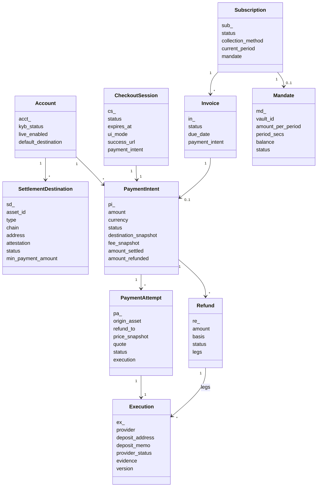
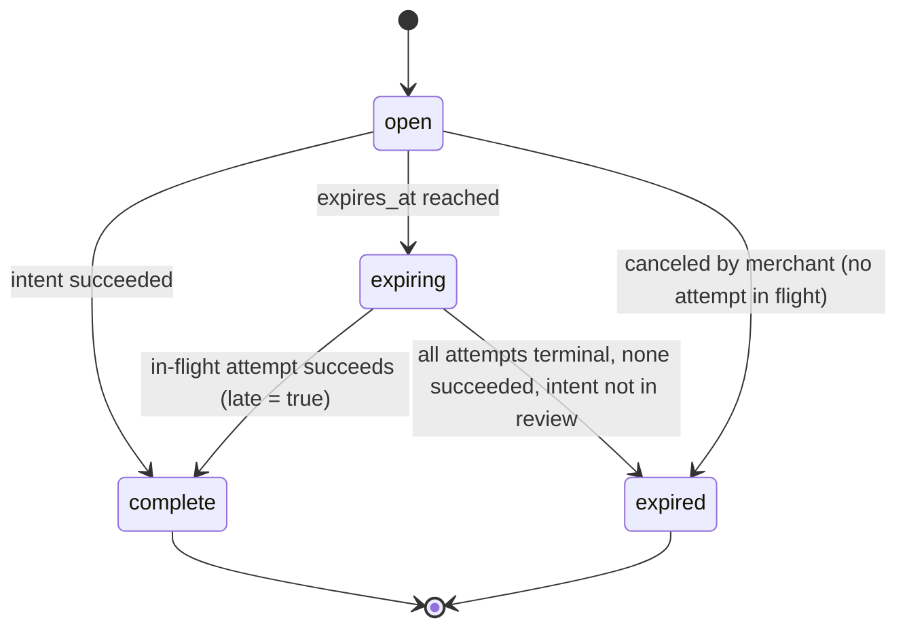
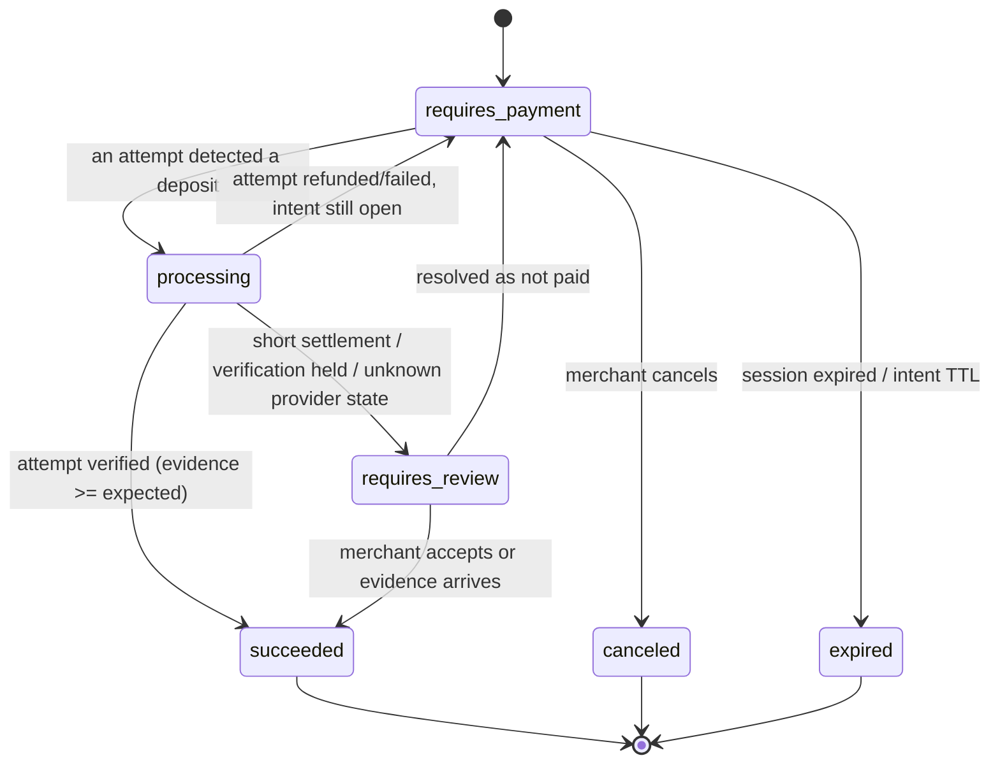
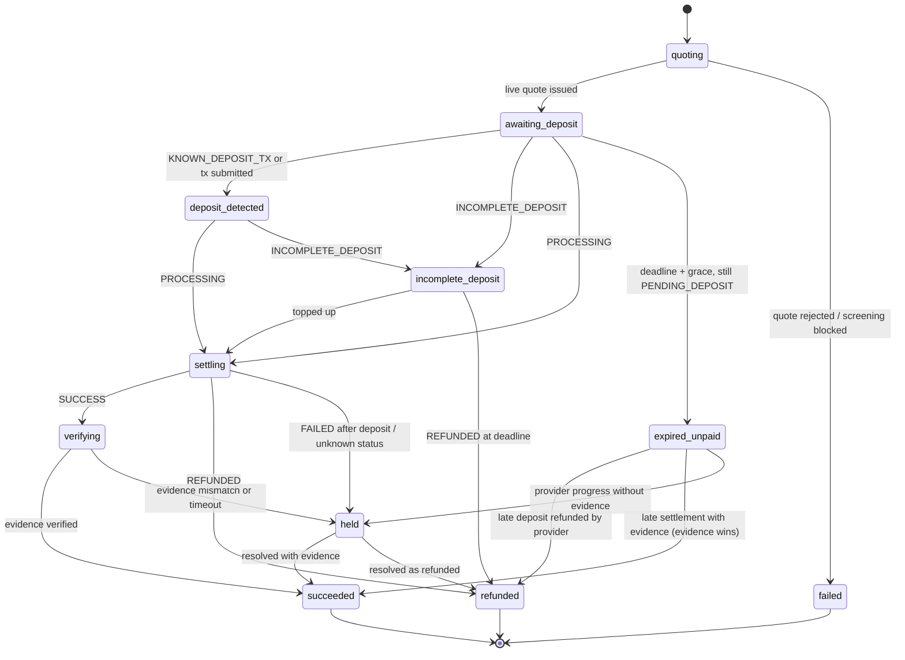
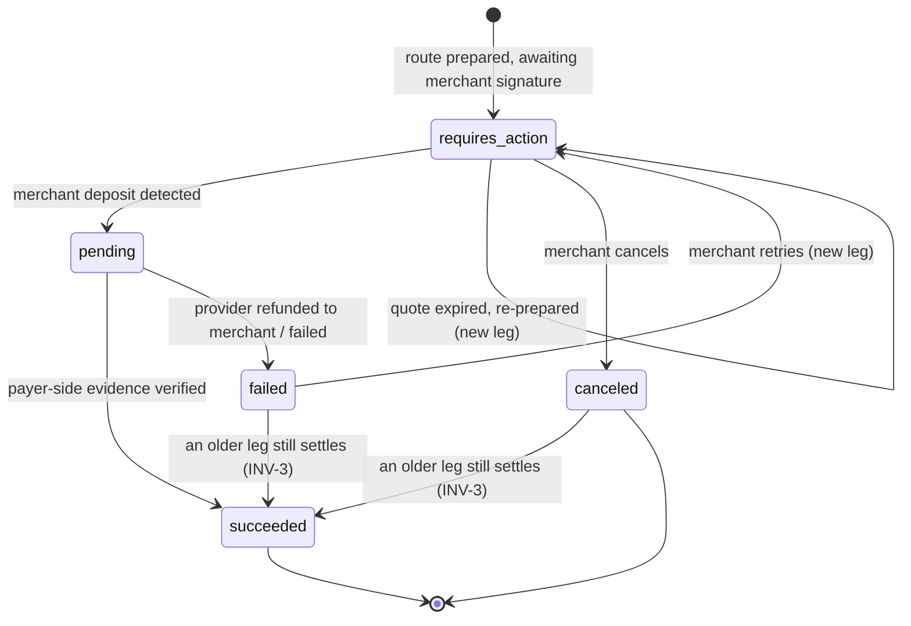
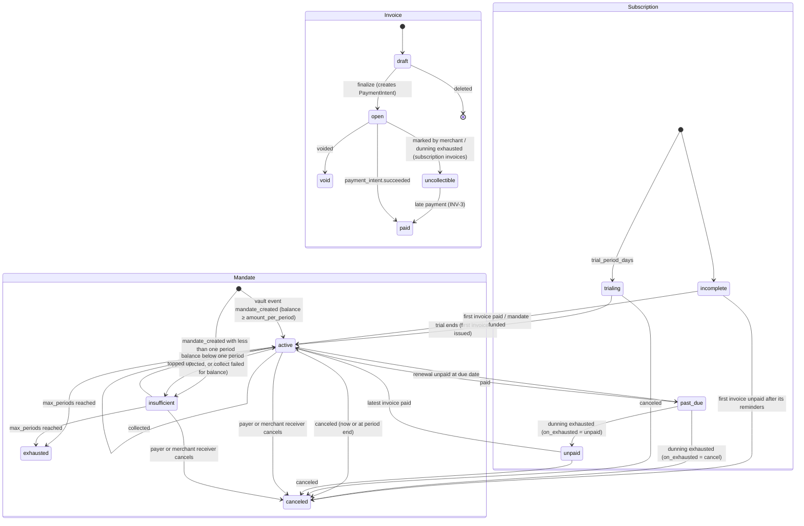

# Domain Model, State Machines and Payment Outcomes

> Version 1.6 (step 4.1, spec 0.4.0: Mandate states and link status §4.5) · Version 1.5 (step 3.1, spec 0.3.0: `txr_`, `il_`, `si_` prefixes; billing state machines §4.5) · Version 1.4 (step 2.1, spec 0.2.0: `inv_`, `aud_`, `opa_`, `bl_`, `rcn_` prefixes; refund edges `canceled|failed → succeeded` §4.4; reconciliation runs §6) · Version 1.3 (step 1.4: `whd_` prefix, spec 0.1.5) · Version 1.2 (step 1.2: `pol_` and `ks_` prefixes, late settlement of expired executions, sessions wait on review) · Version 1.1 ID prefixes completed in step 1.1 (`nearpay-spec` `ID_PREFIXES` is the machine-readable list) · Owners per aggregate are binding (see HLD §5.1). Public field names follow `architecture/api-conventions.md`.

## 1. Identifiers

`<prefix>_<base32(UUIDv7)>` — time-sortable, opaque, never reused; encoded as TypeID (26 lowercase Crockford base32 symbols, first symbol 0–7). `livemode` is a field, not part of the ID.

| Prefix | Object | Owner |
|---|---|---|
| `acct_` | Account (merchant) | identity |
| `usr_` | User | identity |
| `key_` | API key record (the secret itself is `sk_live_…`/`sk_test_…`/`pk_…`/`rk_…`) | identity |
| `sd_` | SettlementDestination | identity |
| `chl_` | Attestation challenge | identity |
| `fs_` | Fee schedule | identity |
| `ses_` | Dashboard session | identity |
| `inv_` | Team invitation (Stage 2) | identity |
| `aud_` | Audit event (Stage 2; the console audit log, one trail) | identity |
| `opa_` | Ops approval — two-person console request (Stage 2) | compliance, sentinel |
| `cs_` | CheckoutSession | payments |
| `pi_` | PaymentIntent | payments |
| `pa_` | PaymentAttempt | payments |
| `re_` | Refund | payments |
| `plink_` | PaymentLink | payments |
| `cus_` | Customer | payments |
| `txn_` | BalanceTransaction (statement line) | payments |
| `rcn_` | Reconciliation run (Stage 2; ops object, never public) | payments |
| `prod_` / `price_` | Product / Price | billing |
| `in_` | Invoice | billing |
| `sub_` | Subscription | billing |
| `txr_` | TaxRate (Stage 3) | billing |
| `il_` | Invoice line item (Stage 3) | billing |
| `si_` | Subscription item (Stage 3) | billing |
| `md_` | Mandate (vault mirror) | billing |
| `ex_` | Execution (route run) | rails |
| `obs_` | Provider observation | rails |
| `ap_` | Agent (facilitator) payment | agentpay |
| `evt_` | Event | webhooks |
| `we_` | WebhookEndpoint | webhooks |
| `whd_` | Webhook delivery | webhooks |
| `case_` | Compliance case | compliance |
| `bl_` | Blocklist entry (Stage 2) | compliance |
| `scr_` | Screening result | compliance |
| `pol_` | Geo policy | compliance |
| `ks_` | Kill switch | sentinel |
| `fnd_` | Audit finding | sentinel |
| `msg_` | Notification message | notify |
| `req_` | API request (`X-Request-Id`) | gateway |
| `job_` | Background job (dead letters reference it) | any service |

## 2. Aggregate map

## 3. Money representation (INV-5, INV-6)

- **Fiat:** `{amount: integer minor units, currency: "usd"}` (ISO 4217, lower-case, minor units per ISO exponent).
- **Asset:** `{amount: "decimal-string of base units", asset_id: "nep141:…"}` — strings because base units exceed 2^53.
- **Snapshots on the PaymentIntent** (immutable after creation):
  - `destination_snapshot` — `{sd_id, asset_id, type, chain, address, attestation_hash}`.
  - `fee_snapshot` — `{schedule_id, total_bps, bearer: merchant|payer, recipients: [{account, bps}]}`.
- **Snapshots on the PaymentAttempt:** `price_snapshot` `{settlement_amount, rates[{pair, value, source, as_of}], par_policy}`, the full provider quote, and `deadline`.

**Settlement amount formula** (fiat-priced intent, destination asset `D`):
`settlement_amount = round_down( amount_fiat × FX(fiat→USD) / price_USD(D) )` in `D` base units — or exactly `amount × 10^(decimals−exponent)` when `D` is a par-policy stablecoin of the same currency.
If `fee_snapshot.bearer = merchant`: quote output = `settlement_amount × (1 − total_bps/10 000)`; otherwise output = `settlement_amount` and the payer's gross input absorbs the fee.

**Amount tag:** the quoted output is then increased by a per-execution tag `t ∈ [1, T]` base units, unique among non-terminal executions to the same `(destination, asset)` (`T` chosen so `T` ≤ USD 0.01 equivalent; 9,999 slots for 6-decimal stablecoins). The merchant always receives ≥ the expected amount (INV-2); the tag lets destination watchers attribute transfers without the provider. Assets where `T` would be too coarse (e.g. very high-value-per-unit with few decimals) skip tagging and rely on provider tx hashes.

## 4. State machines

### 4.1 CheckoutSession

`expiring` exists to honour **INV-3**: a session never reports `expired` while money might still arrive.

### 4.2 PaymentIntent

Post-success the intent stays `succeeded`; refunds are tracked in `amount_refunded` and `refunds[]` (Stripe semantics). Extra settlements after success are recorded as `overpayments[]` (see §5).

### 4.3 PaymentAttempt / Execution (provider-mapped)

| 1Click status | Execution state | Notes |
|---|---|---|
| `PENDING_DEPOSIT` | `awaiting_deposit` | |
| `KNOWN_DEPOSIT_TX` | `deposit_detected` | Not in every documented enum — handled explicitly. |
| `INCOMPLETE_DEPOSIT` | `incomplete_deposit` | Top-up UX only if SP-03 confirms 1Click accepts top-ups to the same address; otherwise "will be refunded at the deadline — start a new payment". |
| `PROCESSING` | `settling` | |
| `SUCCESS` | `verifying` → `succeeded` | Success only after evidence (INV-2). |
| `REFUNDED` | `refunded` | Record `refundedAmount` and refund tx. |
| `FAILED` | `failed` if no deposit seen; else `held` | A failure after deposit means funds are somewhere — needs a case. |
| anything else | `held` + alert | Never assumed terminal. |

`payments` inserts the attempt in `quoting` before calling `rails` (idempotency key `attempt:{id}`), so a crash between the two never loses a live quote.

Every transition is a row in `execution_transitions` with `(from, to, observation_id, source: hot_poll|explorer|indexer|verifier|operator)`. Applying an observation with a lower provider timestamp than the current one is a no-op.

### 4.4 Refund

**Truth wins (INV-3, Stage 2).** `canceled` and `failed` are not final against evidence: if a leg the merchant had already funded still settles payer-side (verified evidence), the refund moves to `succeeded` and is recorded like any success (statement `refund` line, `refund.succeeded`). `pending` (`refund.pending`) means a merchant deposit was detected for the current leg (lld/payments.md §17). The kill switch blocks new live refund legs and live refund relays (fail closed, lld/payments.md §17); refunds resume on release.

`refundable = amount_settled − Σ(refunds in requires_action|pending|succeeded)`, enforced under `SELECT … FOR UPDATE` on the PaymentIntent row.

### 4.5 Billing objects

Mandates (step 4.1, `lld/billing.md` §14): a mandate exists only from the vault's `mandate_created` event (`pending_funding` is never written); every transition follows a forwarded vault event (INV-2). Orthogonal to the status: `link_status` `linked | unlinked` (set once at creation by the §6 linkage rule) and `collecting` (true while linked, on-chain active and the subscription is active and `auto_debit`; turns false for good on release). Billing objects in v1 (step 3.1): invoices are collected with `send_invoice` (Stage 4 adds `auto_debit` for subscription invoices, falling back to `send_invoice`; billing §14 d6); `paid` and `void` are final — money that still settles for them (INV-3) is listed on the invoice and refunded by the merchant, never applied. Exact rules: `lld/billing.md` §4, §11.

### 4.6 SettlementDestination

`pending_verification → cooling_off → active → disabled`. A destination is usable for new intents only when `active`. Disabling never affects intents already snapshotted.

## 5. Payment outcome matrix (FR-PAY-05)

| Situation | Who enforces | Outcome | Merchant event | Payer UX |
|---|---|---|---|---|
| Exact payment | 1Click + verifier | Attempt `succeeded`; intent `succeeded` | `payment_intent.succeeded` | Success → redirect |
| Overpayment within one attempt | 1Click (`EXACT_OUTPUT`) | Merchant gets exact; excess refunded to `refund_to` | `succeeded` (with `payer_excess_refunded`) | Shows refund of excess |
| Underpayment ≥ `minAmountIn` | 1Click | Treated as paid (slippage band) | `succeeded` | Success |
| Underpayment < `minAmountIn` | 1Click | `incomplete_deposit` → top-up (if SP-03 allows) or refund at deadline | `payment_intent.payment_failed` (reason `underpaid`) if refunded | Top-up instructions with countdown, or refund notice + new payment |
| Slow route chosen near session end | payments | Route hidden if its minimum deadline exceeds the remaining window | — | Only routes that fit the window are offered |
| Payer sends to an older attempt's address | 1Click + payments | Tracked until terminal; if it settles first it wins, otherwise `overpaid` | as applicable | Old address hidden with "don't send again" |
| Deposit after deadline | 1Click | Refunded; attempt `expired_unpaid → refunded` | none (or `payment_failed` if it was the last hope) | "Address expired — do not send" banner after deadline |
| Two attempts both settle | payments | First wins; second recorded as `overpayments[]`; refund recommended | `payment_intent.overpaid` | Shown both receipts |
| Settles after session expiry | payments (INV-3) | Session `complete` with `late = true` | `succeeded` + `checkout.session.completed` (`late: true`) | Success |
| Settlement short of expected | verifier | Intent `requires_review`; auto-accept if within merchant tolerance | `payment_intent.requires_review` | "Merchant reviewing" |
| Provider `SUCCESS`, no on-chain evidence | verifier | `held`; page on-call; no success event | none until resolved | "Confirming" with support link |
| Wrong chain / missing memo | payer error | Not observable by NearPay; recovery case with provider | none | Prevention: wallet-connect default, chain/memo guards |
| Sanctioned sender detected post-deposit | compliance | Payment stands (non-custodial); case opened; merchant notified | `payment_intent.succeeded` + `review.opened` | — |

## 6. Statement ledger (BalanceTransaction)

NearPay holds no balances, so the "ledger" is a **statement** of what settled where, used for reconciliation and exports:

| `type` | Created when | Fields |
|---|---|---|
| `payment` | intent succeeded | gross (fiat), settled (asset), fee (bps and estimated asset amount), destination, evidence |
| `overpayment` | extra settlement recorded | settled, evidence |
| `refund` | refund succeeded | amount (asset), evidence |
| `fee_adjustment` | reconciliation finds observed fee ≠ expected | delta |

Daily reconciliation (per merchant, per asset): Σ statement = Σ verified evidence; fees reconciled against Explorer `appFees`. Any non-zero diff opens an ops case (target: zero). Stage 2: each run is an append-only `ReconciliationRun` (`rcn_`; a re-run records `rerun_of`), read and resolved in the console (`/ops/reconciliation_runs…`, served by payments); a `diff`/`error` run makes payments open a `reconciliation_diff` compliance case (`POST /internal/cases`), so diffs share the ops case queue (lld/payments.md §9, lld/compliance.md).
