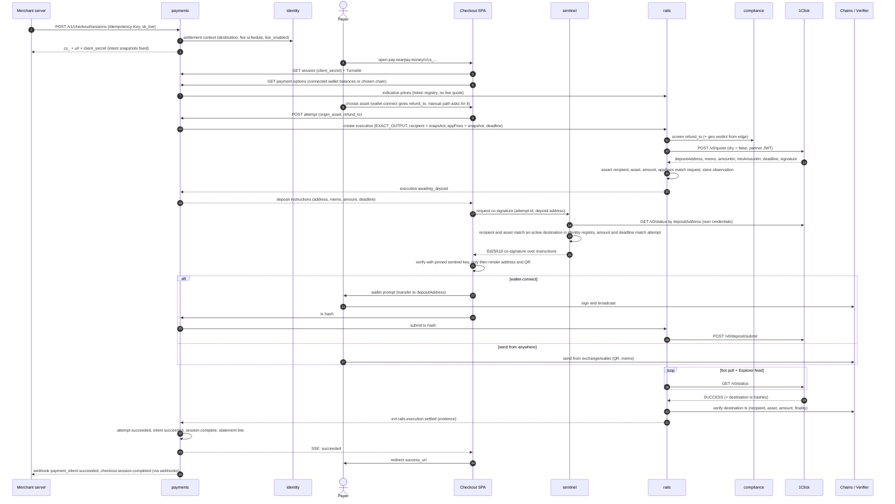
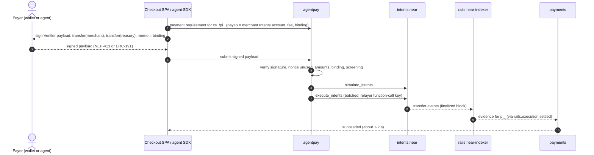
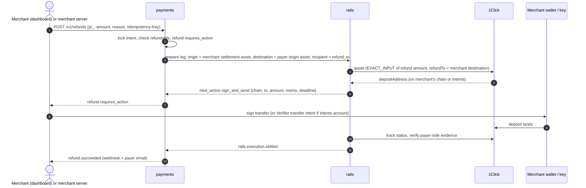
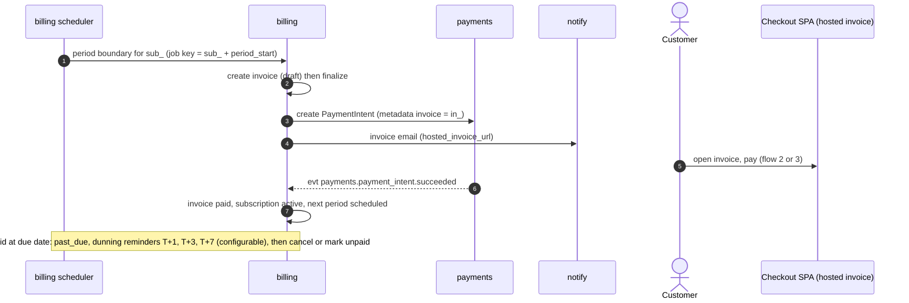
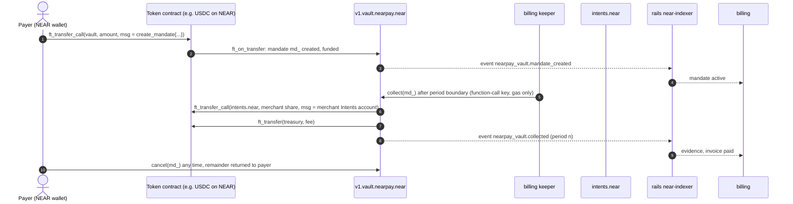
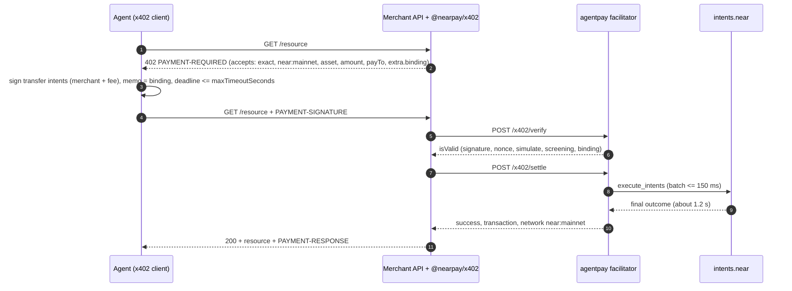
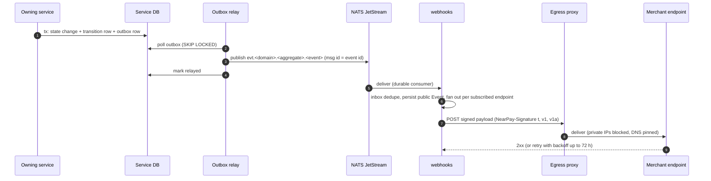

# Core Flows

> Version 1.2 (§1 onboarding: open onboarding — automatic KYB decision, no ops step, ADR-0024) · Version 1.1 (§1 onboarding: v1 self-declared KYB, ADR-0020) · Version 1.0 · Sequence-level detail for HLD §7. Service names = repos without the `nearpay-` prefix.

## 1. Merchant onboarding and settlement destination

```mermaid
sequenceDiagram
  autonumber
  actor M as Merchant owner
  participant D as Dashboard SPA
  participant ID as identity
  participant C as compliance
  participant O as Ops console
  participant W as Merchant wallet
  M->>D: sign up (email + passkey)
  D->>ID: create account (test mode on immediately)
  M->>D: save business details (registration number optional)
  D->>C: submit self-declared business details (KYB case)
  C->>C: same tx: kyb.submitted + automatic decision (actor system; geo policy hit = rejected, ADR-0024)
  Note over O,C: NP_KYB_MODE=manual only: ops KYB decision in the console
  C-->>ID: evt compliance.kyb.approved
  M->>D: add destination (asset, chain or Intents account, address)
  D->>ID: POST /v1/settlement_destinations (step-up passkey)
  ID->>C: screen address (sync)
  ID-->>D: attestation challenge (account, destination, nonce, expiry)
  D->>W: signMessage (NEP-413 / EIP-191 / Solana / BIP-322)
  W-->>D: signature
  D->>ID: submit attestation
  ID->>ID: verify signature, status = cooling_off (24 h), second approver if required
  ID-->>M: email + dashboard notice to all owners
  Note over ID: after cool-off: status = active, evt identity.settlement_destination.activated
  ID-->>ID: live_enabled when KYB approved and >= 1 active destination
```

## 2. Checkout — cross-chain, any asset (the main path)



**Rules embedded in the flow**
- Live quotes are created only on explicit payer confirmation (Turnstile-protected, ≤ 5 live attempts per session, per-IP and per-merchant limits) — browsing uses indicative prices.
- **Crash safety:** `payments` inserts the attempt (`quoting`) *before* calling `rails`; the execution call is idempotent on `attempt:{id}`; a recovery worker resumes attempts stuck in `quoting`. An orphaned quote is harmless (no one sees its address).
- **Two-party release:** no address is rendered without sentinel's co-signature (fail-closed).
- The deposit address is displayed only inside `pay.nearpay.money` (never in the merchant's DOM).
- **One visible attempt:** creating a new attempt hides the previous address with "If you already sent to the previous address, don't send again — we'll detect it"; the previous execution stays tracked until terminal.
- **Window rule:** an attempt's deadline never exceeds the session's `expires_at` (unless the merchant allows late payments); slow routes are hidden when the remaining window is too short.
- After `deadline` the address is hidden and replaced by "expired — do not send"; a new attempt can be created while the session is `open`.
- **Payer guards:** wallet-connect is the default; the manual path shows network name + icon prominently, requires confirming the network, makes memos impossible to miss (checkbox "I included the memo"), and asks for a refund address the payer controls (not an exchange deposit address).

## 3. Intents-native payment (payer already holds a NEAR Intents balance)



Only valid when the merchant destination is an Intents account in the paid asset (or the merchant enables "accept Intents balance in asset X" — then settlement asset = X for that payment, recorded on the attempt).

## 4. Refund (merchant-authorised)



If the quote deadline passes unsigned, the leg expires and `payments` prepares a new leg on demand; a merchant cannot change `recipient` except via an owner override with step-up auth and fresh screening (INV-7).

**Refund fees:** NearPay charges no fee on refunds (no `appFees`) and does not return the original fee. `fee_mode = payer_absorbs` (default, `EXACT_INPUT`: payer receives the refund amount minus route costs) or `merchant_absorbs` (`EXACT_OUTPUT`: payer receives the equivalent of the refunded amount; merchant sends slightly more). Refunds of Intents-native payments are a merchant-signed Verifier `transfer` back to the payer's Intents account — no route provider involved.

## 5. Invoice and `send_invoice` subscription renewal



## 6. `auto_debit` subscription via vault



`collect` is idempotent per `(mandate, period)` on-chain; failed transfers roll back the period in the resolve callback.

## 7. Agent payment over x402 (`exact` + `intents-transfer`)



`settlement_pending` (non-terminal) is returned if finality is not reached within the request budget; the middleware retries `settle` with the same payload (idempotent on payload hash).

## 8. Event and webhook delivery


