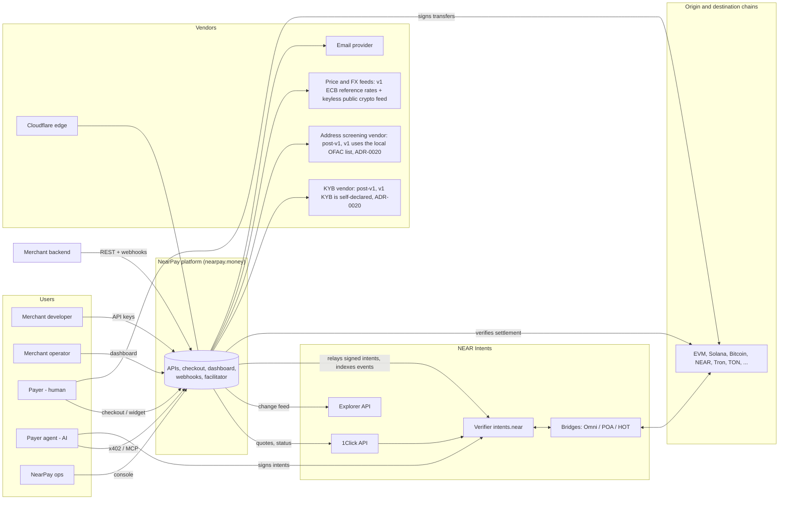
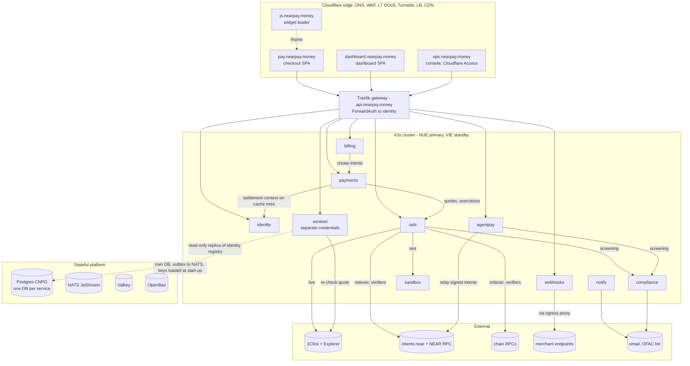

# NearPay — High-Level Design (HLD)

> Version **1.1** (stress-tested, see §21 and `quality/stress-test.md`; v1 runtime per ADR-0015) · Date 2026-11-05 · Owner: Principal Architect
> Read first: `product/brief.md`, `product/requirements.md` (invariants **INV-1…9** are referenced throughout).

---

## 1. Context in one paragraph

NearPay is a non-custodial, chain-abstracted merchant payments platform. Merchants integrate a Stripe-like API, widget and webhooks; payers pay with any token on any chain; merchants receive any asset they choose, either on a destination chain or in their NEAR Intents account. Value movement is delegated to **NEAR Intents** (via the **1Click API** for cross-chain/any-asset routes and directly via the **Verifier `intents.near`** for signed transfers). NearPay owns everything around the money movement: objects and state machines, evidence and reconciliation, webhooks, refunds, billing, agent payments, compliance and developer experience. NearPay never holds funds (INV-1).

## 2. Architectural drivers → responses

| # | Driver | Architectural response |
|---|---|---|
| D1 | **Never custody funds** (regulatory + trust) | All value moves payer → route → merchant. Fees taken in-flight via `appFees`. NearPay hot keys are NEAR *function-call* keys that can only pay gas / submit owner-signed payloads (§6). |
| D2 | **Correctness of money state** | Single owner per aggregate, Postgres as system of record, transactional outbox, versioned state machines, evidence-before-success (INV-2), daily reconciliation. |
| D3 | **Dependency on a provider with no webhooks, no SLA, no testnet** | Route-provider abstraction (ADR-0003), hybrid tracking (deposit-signal polling + Explorer feed + own NEAR indexer + destination watchers with amount tags), independent on-chain verification (ADR-0012), sandbox rail for test mode (ADR-0007). |
| D4 | **Any payer asset → any merchant asset** | Destination snapshot per intent; `EXACT_OUTPUT` quotes; token registry & pricing in `rails`; per-destination minimums. |
| D5 | **Account-takeover = theft of future revenue** | Destination attestation + step-up + 2-person rule + cool-off + notifications (ADR-0005). |
| D6 | **Agent payments must be ~instant and ~free** | Payer-signed NEAR Intents `transfer` executed by a batching relayer: ~1.2 s finality (ADR-0009). |
| D7 | **Self-hosted on netcup** with small ops footprint | k3s on root servers, two EU sites + witness, few stateful components, GitOps, off-provider backups (ADR-0011). |
| D8 | **AI-agent-built polyrepo** | Contract-first `nearpay-spec`, bounded-context repos, no source-level coupling, per-repo `AGENTS.md`, brain as single source of cross-cutting truth (ADR-0001). |

## 3. System context

## 4. Decision summary

| ADR | Decision |
|---|---|
| [0001](../decisions/ADR-0001-polyrepo-contract-first.md) | Polyrepo by bounded context; contract-first `nearpay-spec`; brain repo for cross-cutting docs |
| [0002](../decisions/ADR-0002-non-custodial-near-intents.md) | Non-custodial settlement through NEAR Intents (1Click + Verifier) |
| [0003](../decisions/ADR-0003-route-provider-abstraction.md) | Route-provider abstraction; 1Click first, sandbox second, direct-intents third |
| [0004](../decisions/ADR-0004-postgres-outbox-nats.md) | Postgres per service as system of record; transactional outbox → NATS JetStream |
| [0005](../decisions/ADR-0005-settlement-destinations.md) | Any-asset settlement destinations with ownership attestation and cool-off |
| [0006](../decisions/ADR-0006-fees-via-appfees.md) | Revenue via in-flight `appFees`; fee schedule as data |
| [0007](../decisions/ADR-0007-test-mode-sandbox.md) | Test mode backed by a deterministic sandbox rail (no Intents testnet) |
| [0008](../decisions/ADR-0008-subscriptions.md) | Subscriptions: `send_invoice` everywhere; `auto_debit` via immutable NEAR vault |
| [0009](../decisions/ADR-0009-agent-payments-x402.md) | Agent payments: x402 v2 facilitator with `intents-transfer` + `near-intents` methods |
| [0010](../decisions/ADR-0010-checkout-isolation.md) | Checkout as static SPA on its own origin; widget = iframe + postMessage |
| [0011](../decisions/ADR-0011-netcup-k3s-two-site.md) | netcup root servers, k3s, NUE primary / VIE standby / AMS witness |
| [0012](../decisions/ADR-0012-independent-verification.md) | Evidence-before-success with chain verifiers (Tier A/B) |
| [0013](../decisions/ADR-0013-typescript-rust.md) | TypeScript (Node 22, Fastify) for services/frontends; Rust for NEAR contracts |
| [0014](../decisions/ADR-0014-auth-gateway.md) | Traefik gateway + ForwardAuth to `identity`; internal short-lived JWTs |
| [0015](../decisions/ADR-0015-v1-single-host-compose.md) | **v1:** every service its own container in one Docker Compose stack on a single host (local first, netcup last) |
| [0016](../decisions/ADR-0016-entry-repo-and-hackathon.md) | Thin `nearpay` entry repo; NEAR Hackathon compliance (tracks Real-World Money + Agent Economy) |
| [0017](../decisions/ADR-0017-git-workflow.md) | Git workflow: `main` + feature branches merged by pull request |
| [0018](../decisions/ADR-0018-list-filters-not-search.md) | Typed filters on list endpoints instead of search endpoints |
| [0019](../decisions/ADR-0019-site-repo.md) | One `nearpay-site` repo for the docs and marketing sites |
| [0020](../decisions/ADR-0020-v1-delivery-and-vendor-scope.md) | **v1 by 2026-11-14:** stages exit on green test-mode E2E, one v1 mainnet demo; self-declared KYB + ops decision (no KYB vendor); local OFAC screening behind a vendor-neutral interface; ECB FX + keyless public crypto price feed; AI-agent vault audits (mainnet deploy human-signed); merges, incl. money paths, delegated to the lead agent |
| [0021](../decisions/ADR-0021-shared-ui-package.md) | `@nearpay-internal/ui` (design system) is a versioned nearpay-kit package consumed by checkout, dashboard, console and site; CSS custom properties + plain CSS classes + thin React components, no runtime CSS-in-JS, CSP-safe, self-hosted DM Sans |

## 5. Container view

### 5.1 Responsibilities

| Container | Owns (aggregates) | Public surface | Process types | Key dependencies |
|---|---|---|---|---|
| **identity** | Account, User, Membership/Role, Session, Passkey, ApiKey, SettlementDestination, Approval | `/v1/account`, `/v1/settlement_destinations`, `/v1/api_keys` (session-only), `/authz` (gateway) | api | compliance (screen dest), notify, OpenBao |
| **payments** | CheckoutSession, PaymentIntent, PaymentAttempt, Refund, PaymentLink, Customer, BalanceTransaction | `/v1/checkout/sessions`, `/v1/payment_intents`, `/v1/refunds`, `/v1/payment_links`, `/v1/customers`, `/v1/balance_transactions`, SSE stream | api, workers (expiry, quoting-recovery, apply-observations, reconciliation) | identity (settlement-context read model from events; sync call on miss), rails |
| **billing** | Product, Price, Invoice, Subscription, Mandate (mirror of vault) | `/v1/products`, `/v1/prices`, `/v1/invoices`, `/v1/subscriptions`, `/v1/mandates` | api, scheduler, keeper | payments, notify, NEAR RPC |
| **rails** | Token registry, Price snapshot, Execution, ProviderObservation, Verification | `/v1/assets` (read-only); internal `/executions`, `/quotes` | api, hot-poller, explorer-feed, near-indexer, destination-watchers, verifier, archiver | 1Click, Explorer, NEAR RPC, chain RPCs, compliance, sandbox |
| **agentpay** | FacilitatorPayment, RelayBatch, RelayerKey | `/x402/supported`, `/x402/verify`, `/x402/settle`, `/v1/checkout/sessions/{id}/agent_pay` | api, batcher | intents.near, compliance, payments |
| **compliance** | ScreeningResult, KybCase, GeoPolicy, Case, Blocklist | internal only (+ console) | api, refresher | local OFAC list + blocklist (v1; screening and KYB vendors post-v1, ADR-0020) |
| **webhooks** | Event (public log), WebhookEndpoint, Delivery | `/v1/events`, `/v1/webhook_endpoints` | api, ingest, dispatcher | NATS, egress proxy |
| **notify** | Template, Message | internal | worker | email provider |
| **sandbox** | Simulated quotes/executions/chains | internal (`rails` test-mode provider) | api | — |
| **sentinel** | IntegrityCheck, AuditFinding | `/v1/attestations/deposit_instructions` (co-signature for checkout), kill switch | api, auditor | identity read replica, 1Click status, chain RPCs (own credentials) |
| **checkout SPA** | — (stateless) | `pay.nearpay.money` | static | gateway, wallets |
| **widget** | — | `js.nearpay.money/v1/nearpay.js` | static | checkout iframe |
| **dashboard SPA** | — | `dashboard.nearpay.money` (`/api/*` proxied same-origin) | static | gateway |
| **ops console** | — | `ops.nearpay.money` (Cloudflare Access + hardware keys) | static | gateway (ops scopes) |

**Rule:** an aggregate has exactly one owning service; other services hold read models built from events or call the owner. No service reads another service's database (enforced by separate DB roles).

## 6. Trust boundaries and money authority

The core question for a non-custodial design is *"who can move which funds?"*. This table is exhaustive and is re-checked on every ADR.

| Funds | Who can move them | NearPay's power |
|---|---|---|
| Payer's wallet funds | Payer (signs transfer) | None |
| Funds at a 1Click deposit address | 1Click/solver network per quote rules (swap → recipient, or refund → `refundTo`) | None (only *chooses* recipient = merchant's snapshotted destination at quote time) |
| Merchant destination address / Intents account | Merchant keys | None |
| Payer's Intents balance (agents) | Payer keys (signed intents) | Relays signed payloads; cannot alter them |
| Subscription vault balances | Contract rules: payer may withdraw/cancel any time; `collect` releases ≤ mandate amount per period to the mandated merchant | Can call permissionless `collect`; no admin method moves funds |
| `appFees` in treasury | Treasury multisig (hardware keys, 2-of-3) | Owned revenue |
| Relayer / keeper accounts (gas) | NearPay hot function-call keys, allowance-capped | Gas only |

**Residual power:** NearPay chooses the quote `recipient` at quote time. A compromised `payments`/`rails` tier could quote to an attacker address. Defence in depth:
1. The destination snapshot originates only in `identity` (separate DB, role and CODEOWNERS); `rails` asserts `quote.recipient == snapshot`.
2. **Two-party release of deposit instructions:** the checkout SPA renders a deposit address only together with a **co-signature from `nearpay-sentinel`** (Ed25519 key pinned in the SPA build). Sentinel signs only after it independently (own code, own credentials) re-reads the quote from 1Click status by `depositAddress` and confirms `recipient`/`destinationAsset` match an **active destination in identity's registry** (read-only replica role) for that account, and amount/deadline match the attempt. Fail-closed; p99 budget 1.5 s (one provider status call; cached ≤ 50 ms).
3. The checkout SPA is built and deployed by a separate pipeline (SRI, CSP) and shows the merchant's KYB-approved legal name (self-declared and approved by ops in v1, ADR-0020) and destination fingerprint.
4. ⚠ Client-side verification of 1Click's own quote `signature` once the scheme is confirmed (SP-01).
Remaining exposure requires compromising `identity` *and* bypassing its attestation/cool-off/notification controls — see `architecture/security.md` T-03.

## 7. Core flows (summary — full sequences in `architecture/flows.md`)

1. **Checkout (cross-chain/any-asset):** merchant creates session → payer opens hosted page/widget → selects asset (wallet-connect or manual) → `payments` creates attempt → `rails` screens refund address, requests `EXACT_OUTPUT` quote (`recipient` = destination snapshot, `appFees` = fee snapshot, `refundTo` = payer origin) → `sentinel` co-signs the deposit instructions → payer deposits → trackers observe → verifier confirms evidence → intent `succeeded` → events → webhooks/receipt → redirect.
2. **Intents-native payment:** payer with an Intents balance (wallet or agent) signs `transfer` intents (merchant amount + fee, memo = payment binding hash) → `agentpay` simulates and relays → Verifier event = evidence → success in ~1–2 s.
3. **Refund:** merchant creates refund → `rails` prepares a quote from the merchant's settlement asset to the payer's origin asset/address → merchant signs the deposit (dashboard wallet or own backend) → tracked like a payment.
4. **Invoice:** billing finalises invoice → creates PaymentIntent → hosted invoice page (checkout app) → paid event closes invoice.
5. **Subscription:** scheduler creates renewal invoice per period (idempotent); `send_invoice` → email + dunning; `auto_debit` → keeper calls vault `collect` → vault event = evidence → invoice paid.
6. **Agent x402:** resource server returns 402 with NearPay requirements → agent signs → server calls `/verify` then `/settle` → serves resource with `PAYMENT-RESPONSE`.

## 8. Data architecture

| Store | Role | Notes |
|---|---|---|
| **PostgreSQL 17** via CloudNativePG | System of record; one database + role per service | Sync replica in-region (RPO 0); replica cluster in VIE; WAL archive + base backups to off-provider EU S3 (35 d). |
| **NATS JetStream** | Domain event transport (not a source of truth) | Streams per domain, 7-day retention; rebuildable from outboxes. |
| **Valkey** | Rate limits, auth cache, SSE fan-out, short-lived locks | Ephemeral; loss = degraded latency only. |
| **OpenBao** (post-v1; v1 uses SOPS + Docker secrets, ADR-0015) | Secrets, relayer keys, envelope-encryption KEKs | 5-node Raft across NUE(2)/VIE(2)/AMS(1). **Off the request hot path:** signing keys (internal JWT, webhook Ed25519, sentinel) are loaded into memory at start-up and rotated; PII uses envelope encryption with data keys cached ≤ 1 h. A sealed OpenBao stops new pods from starting, not running traffic. |
| **Object storage** (off-provider, EU S3) | Backups, exports, invoice PDFs, audit archives | Separate credentials per writer; object lock for audit archive. |

**Money tables** are append-friendly: state is a row with `version`; every transition inserts into `<aggregate>_transitions` (from, to, actor, reason, evidence_ref) in the same transaction as the outbox row (INV-4, INV-9). Provider responses are stored verbatim in `provider_observations` (rails) with hash and receive time.

**Data classification:** PII (emails, names, IPs) is field-encrypted with envelope encryption (KEK in OpenBao, data keys cached ≤ 1 h) and pseudonymised on erasure; on-chain data (addresses, tx hashes) is treated as pseudonymous personal data and retained for AML (default 5 years, policy-configurable per jurisdiction).

## 9. Integration architecture

- **Sync (commands/queries):** internal HTTP/JSON with OpenAPI from `nearpay-spec`; requests carry an internal JWT (minted by `identity` at the gateway, 60 s TTL, audience-scoped) plus W3C trace context. Cilium enforces which service may call which.
- **Async (facts):** outbox row → relay → NATS subject `evt.<domain>.<aggregate>.<event>` → durable consumers with an `inbox` dedupe table (event ID) → idempotent handlers. Events carry `aggregate_version`; consumers ignore stale versions.
- **Idempotency:** public `Idempotency-Key` handled inside the owning service's DB transaction (no separate store), so the response and the side effect commit atomically. Internal commands carry a deterministic key (e.g. `attempt:{id}:execution`).
- **Timeouts/retries:** every outbound call has a deadline budget derived from the inbound request; retries only for idempotent operations with jittered backoff; circuit breakers per upstream.
- **Contract evolution:** additive-only changes within an API version; breaking changes get a new dated version (public) or a new path version (internal). Consumer-driven contract tests live in `nearpay-testbed`.

## 10. Rails architecture (value movement)

```mermaid
flowchart LR
  REQ[payments: create execution] --> SCR{screen refundTo<br/>and destination}
  SCR -- blocked --> X[reject: compliance]
  SCR -- ok --> PRV{provider by livemode<br/>and route}
  PRV -- live --> ONE[OneClickProvider<br/>EXACT_OUTPUT quote]
  PRV -- test --> SBX[SandboxProvider]
  ONE --> CHK[assert recipient, amount,<br/>asset, appFees, deadline]
  CHK --> STO[(execution + observation)]
  STO --> TRK
  subgraph TRK[Tracking]
    HP[hot poller<br/>/v0/status]
    EF[Explorer change feed<br/>1 req per 5 s]
    NI[NEAR indexer<br/>intents.near events]
    DW[destination watchers<br/>amount-tag attribution]
  end
  TRK --> MAP[map provider status<br/>to execution state]
  MAP --> VER{terminal success?}
  VER -- yes --> CV[chain verifier<br/>Tier A: on-chain evidence]
  CV --> EVT[outbox: rails.execution.settled]
  VER -- no --> EVT2[outbox: rails.execution.updated]
```

- **Provider interface:** `listAssets()`, `quote(dry)`, `createExecution()`, `submitDepositTx()`, `getStatus()`, `listChanges(cursor)`. Implementations: `oneclick`, `sandbox`, (later) `direct-intents`.
- **Tracking strategy** (no provider webhooks):
  - *Hot poller* — polls only executions with a **deposit signal** (tx hash submitted by wallet-connect, payer pressed "I've sent it", or an Explorer change): exponential 2 s → 4 s → 8 s, then every 15 s while `deposit_detected`/`settling` (watchers usually confirm first); awaiting-deposit executions without a signal get one check at deadline + grace (Explorer covers the rest). Stops at terminal + 10 min grace. Global token bucket sized to the negotiated 1Click limit with priority (tx-hash > signalled > sweep).
  - *Explorer feed* — leader-elected single consumer reading `referral=nearpay` transactions every 5 s (≤ 1,000 rows), rotating over in-flight statuses and recently-terminal windows with an overlapping time cursor (filter semantics: SP-10); nudges executions whose status changed. Backstop for refunds/failures and unsignalled deposits.
  - *Archiver* — moves provider observations older than 90 days to Parquet in object storage, keeping hashes in Postgres (F-27).
  - *NEAR indexer* — streams finalized blocks, filters `intents.near` and vault events for known merchant Intents accounts / mandates; gives evidence for `INTENTS` recipients and agent payments without any provider.
  - *Destination watchers* — for Tier-A destination chains (EVM in P1; Solana/Bitcoin in P3) one `eth_getLogs`-style scan per block range over **all** active merchant destination addresses detects incoming transfers. Attribution uses an **amount tag**: each in-flight execution to the same `(destination, asset)` gets a unique sub-cent offset in the least-significant digits of the quoted output (≤ USD 0.01 equivalent, allocated under a unique constraint), so a transfer of exactly `settlement_amount + tag` maps to one execution. Success detection therefore does not depend on provider polling; provider status is needed only for progress UX, refunds and failures.
- **Verification tiers (ADR-0012):** Tier A (NEAR/Intents, EVM chains, Solana, Bitcoin) → independent RPC check of destination tx (recipient, asset, amount ≥ expected, finality per chain). Tier B (other chains) → provider-attested with per-payment limits and daily reconciliation via Explorer. Verification failure → `held` + page on-call; never auto-success.
- **Pricing** (needed only when the settlement asset is not at par with the pricing currency — stablecoin merchants keep working if price feeds fail, because `EXACT_OUTPUT` quotes price the payer's side): token USD prices from `/v0/tokens` (≤ 30 s old) cross-checked against an independent price source (deviation > 1.5% → `pricing_unavailable`); fiat FX from a real-time FX API with ECB fallback (**v1, ADR-0020:** ECB reference rates are the FX source and a keyless public crypto price feed is the independent price source, each behind a provider interface); stablecoin par policy with depeg guard (|price − 1| > 2% disables par). Each attempt stores a `price_snapshot`.
- **Deadlines:** per origin chain profile (e.g. Bitcoin 90 min, Ethereum 30 min, fast chains 20 min); always ≥ provider confirmation needs, bounded so payer refunds aren't locked for long, and **≤ the session's `expires_at`** (strict window, default) — routes whose minimum deadline exceeds the remaining window are hidden. Merchants may opt into `late_payments: allow`.

## 11. Agent payments architecture (summary — ADR-0009, flows §3 and §7)

- `agentpay` is an x402 v2 facilitator: `GET /x402/supported`, `POST /x402/verify`, `POST /x402/settle`.
- **`exact` + `intents-transfer`** (NearPay-native): requirement `{scheme: "exact", network: "near:mainnet", asset, amount, payTo: <merchant intents account>, maxTimeoutSeconds, extra: {transferMethod: "intents-transfer", fee: {to, amount}, binding}}`; payer signs one Verifier payload with two `transfer` intents (merchant + fee) and `memo = binding` (hash of requirement + resource). Verify = signature, nonce unused, `simulate_intents` ok, amounts/payTo/binding match, payer screened. Settle = enqueue into the batcher; result after finality.
- **Batcher:** groups simulated payloads every ≤ 150 ms into `execute_intents`, batch size bounded by **simulated gas** (≤ 80% of max prepaid gas per transaction); per-key nonce pool of N function-call keys for parallel submission; if a batch fails, re-simulate and resubmit individually (SP-07).
- **Economics guard:** each `intents-transfer` payment carries a minimum absolute fee ≥ 2 × its share of relayer gas, plus per-merchant and per-payer rate quotas — so spam cannot burn NearPay's gas.
- **Throughput bound:** `intents.near` lives on one shard shared by all NEAR Intents users; sustained agent throughput is bounded by that shard's gas budget. The 500/s target (NFR-SCL-01) is provisional until SP-07 measures gas per transfer intent; beyond it, a channel-style `upto`/batch-settlement scheme is the v2 path (ADR-0009).
- **`exact` + `near-intents`** (cross-chain upfront, PR #3370-compatible): verify returns a 1Click deposit quote; settle accepts `txHash`; same rails tracking.
- **Merchant middleware** (`@nearpay/x402`) for Express/Hono/Next and an **MCP server** (`@nearpay/mcp`) let agents discover and pay sessions/invoices.

## 12. Billing and subscriptions architecture (summary — ADR-0008)

- Billing is a client of payments (like Stripe Billing over Payments): invoices create PaymentIntents; payment events close invoices.
- **Scheduler:** durable jobs keyed by `(subscription_id, period_start)`; leader-elected; catches up after downtime without duplicates.
- **`auto_debit` vault** (`nearpay-contracts/subscription-vault`, account `v1.vault.nearpay.near`, immutable, no access keys): payer funds a mandate with `ft_transfer_call` (`msg = create_mandate{merchant_receiver, token, amount_per_period, period_secs, start_at, max_periods, fee_bps, fee_receiver, ref}`); `collect(mandate_id)` is permissionless and releases at most one period's amount after the boundary (merchant share deposited into the merchant's Intents account via `ft_transfer_call` to `intents.near`, fee to treasury); `cancel` by payer or merchant returns the remainder to the payer; `withdraw_unused` by payer. On-chain caps per mandate and a global TVL cap during v1.
- Insufficient vault balance → the period falls back to `send_invoice` and the payer is notified to top up.

## 13. Compliance architecture (summary)

- **Pre-transaction:** destination screening (on add, daily), payer origin/refund screening before any live quote, agent payer account screening at `/verify`, geo-policy at checkout (Cloudflare `CF-IPCountry`).
- **Post-transaction:** sender addresses from observations re-screened; hits open cases, notify merchant, and can suspend new sessions — they cannot claw back funds (non-custodial), so preventive controls carry the weight.
- **Failure policy (data, per jurisdiction):** default *fail-closed* for live attempts ≥ USD 1,000 equivalent when the screening provider is unavailable; below that, *proceed + mandatory post-screen*.
- **Screening provider (v1, ADR-0020):** the local OFAC SDN digital-currency list + blocklist behind a vendor-neutral screening interface; a commercial vendor (Q-VEN-02) is a later provider behind the same interface.
- **KYB (v1, ADR-0020):** the merchant self-declares minimum business details; an ops decision in the console (manual KYB decision endpoint) approves or rejects the `KybCase`; no KYB vendor, hosted flow or vendor webhook. `identity` reads KYB status via events to gate live mode.

## 14. Security (summary — `architecture/security.md`)

Passkeys + step-up; hashed API keys with scopes; destination attestation and cool-off; checkout origin isolation (iframe, CSP, SRI, no third-party scripts except Turnstile and bundled wallet adapters); webhook HMAC + Ed25519 signatures; SSRF-safe egress proxy; OpenBao for secrets and PII encryption; signed images and SBOMs; hot keys are allowance-capped function-call keys; treasury is a hardware multisig; contracts immutable and audited (v1: independent AI-agent audits, human audit recommended before material value — ADR-0020); ops console behind Cloudflare Access with hardware keys; every admin action audited.

## 15. Deployment and infrastructure (summary — `architecture/infrastructure.md`)

### 15.1 v1 (ADR-0015) — what we build and ship first

| Concern | Target design (post-v1) | **v1 (single host, Docker Compose)** |
|---|---|---|
| Hosts | NUE ×3, VIE ×3, AMS witness | Local machine during development; one netcup server (root server recommended) in the final stage |
| Orchestration | k3s, Argo CD, Rollouts, Kyverno | `docker compose` with profiles (`local`, `server`, `observability`); deploy script in `nearpay-deploy` |
| Services | 10 services, separate deployables | **Same 10 services, each its own container** (api and worker process types as separate Compose services) |
| Postgres | CNPG, sync replica, replica cluster | One PostgreSQL 17 container, database + role per service; WAL-G to off-host S3 (RPO ≤ 60 s) |
| Events | NATS JetStream R3 | NATS JetStream single node (file storage); outbox is the source of truth |
| Secrets | OpenBao 5-node Raft | SOPS + age → Docker secrets (files); same `secrets` port in code |
| Network policy | Cilium | One Docker network per concern (`edge`, `internal`, `data`, `egress`); only gateway on `edge`; only egress proxy and rails/agentpay/sentinel/compliance/notify reach the internet |
| Edge | Cloudflare LB, WAF, Access | Local: Traefik on `*.nearpay.localhost`; server stage: Cloudflare proxy + Authenticated Origin Pulls |
| Availability | 99.95% | 99.5% (single host); money safety unchanged |

### 15.2 Target topology (post-v1, ADR-0011)

- **Sites:** NUE primary (3 × RS 4000 G12.5), VIE warm standby (3 × RS 4000), AMS witness + observability (VPS). Cloud VLAN in-site, WireGuard between sites.
- **Platform:** k3s HA (embedded etcd), Cilium (policies + WireGuard encryption), Traefik, CloudNativePG, NATS, Valkey, OpenBao, Argo CD.
- **Edge:** Cloudflare DNS/WAF/Turnstile/CDN/Load Balancer (health-checked origins; NUE active, VIE standby), Authenticated Origin Pulls; origins accept Cloudflare IPs only.
- **Environments:** `local` (testbed compose), `staging` (single site, sandbox + tiny-mainnet), `production`.
- **Supply chain:** GitHub Actions → GHCR images (cosign-signed, SBOM, scanned) → PR to `nearpay-deploy` → Argo CD.

## 16. Observability and SLOs (summary — `operations/slos.md`)

OpenTelemetry everywhere → VictoriaMetrics / Loki / Tempo / Grafana in AMS (outside the failure domain it watches). Business SLIs: payment success rate by route, time-to-evidence p50/p95 by chain pair, quote error rate, provider status distribution, webhook latency, reconciliation diffs, verifier holds. Mainnet **canary payments** (USD 1 every 15 min over key routes) detect rail degradation before merchants do.

## 17. Scalability (summary — `quality/capacity.md`)

Stateless tiers scale horizontally; Postgres is far from its limits at v1 targets (≈ 3k row-writes/s at 100 payments/s). The binding constraints are **external** and quantified in `quality/capacity.md`: (1) 1Click status limits — reduced to ≈ 10 status calls per cross-chain payment by deposit-signal polling, and made non-critical for success detection by destination watchers + amount tags; the exact ceiling awaits SP-04; (2) `intents.near` shard gas for agent payments (SP-07); (3) per-key NEAR nonces (key pool).

## 18. Degradation matrix

| Failure | Payer impact | Merchant impact | Money safety |
|---|---|---|---|
| 1Click quotes down | Cross-chain options hidden; Intents-native pay still works | New cross-chain payments paused | Safe |
| 1Click status down | Progress updates slower | Tier-A successes still confirmed by watchers/indexer; refunds detected later via Explorer | Safe |
| Explorer API down | None while hot poller covers active sessions | Unattended payments detected slower | Safe |
| NEAR RPC provider down | None (multi-provider pool) | None | Safe |
| Screening provider unavailable (v1: local list missing) | ≥ USD 1k live attempts blocked | Larger payments paused | Safe |
| NearPay NUE site down | Checkout unavailable until failover (≤ 30 min) | API down; no events lost | **Safe — in-flight swaps complete on NEAR Intents; trackers catch up from the Explorer cursor** |
| NATS down | None | Webhooks delayed; outbox buffers | Safe |
| Email provider down | Receipts delayed (fallback provider) | Invoice emails delayed | Safe |
| Price/FX feeds down | Non-par settlement assets unavailable | Stablecoin-settling merchants unaffected | Safe |
| Turnstile down | Live attempts allowed under stricter per-IP limits | None | Safe |
| Sentinel down | Deposit addresses not shown (fail-closed); Intents-native signed payments still work | Cross-chain checkout paused | **Safe by design** |
| Postgres primary failover in-site (≈ 30 s) | Brief 503s on writes; auth keeps working from cache + replica | Retries with Idempotency-Key succeed | Safe |
| OpenBao sealed | None for running pods | Deploys/scale-ups blocked until unsealed | Safe |
| **v1 single host down** | Checkout unavailable until restart/restore (RTO ≤ 4 h on a new host) | API down; no events lost (outbox in Postgres, WAL off-host) | **Safe** |

**Key property:** because NearPay is never in the money path, *any* NearPay outage delays information, never funds.

## 19. Repository topology (summary — `architecture/repositories.md`)

27 repositories under the `nearpay-money` GitHub org, grouped: **entry** (`nearpay` — the hackathon submission URL: guide, repo manifest, bootstrap and run scripts; ADR-0016), **knowledge** (`nearpay-brain`), **contracts & shared** (`nearpay-spec`, `nearpay-kit`), **services** (`nearpay-identity`, `-payments`, `-billing`, `-rails`, `-agentpay`, `-compliance`, `-webhooks`, `-notify`, `-sandbox`, `-sentinel`), **frontends** (`nearpay-checkout`, `-js`, `-dashboard`, `-console`, `-docs`, `-web`), **SDKs & tools** (`nearpay-node`, `-agentkit`, `-cli`), **on-chain** (`nearpay-contracts`), **platform** (`nearpay-infra`, `-deploy`, `-testbed`). Dependency rule: repos depend only on published artifacts (spec packages, kit packages, images), never on each other's source.

## 20. Evolution and extension points

| Future capability | Extension point already in place |
|---|---|
| Second route provider / direct Message Bus routing | `RouteProvider` interface; provider chosen per attempt |
| Marketplace splits (Connect) | `appFees[]` supports multiple recipients; fee snapshot is a list |
| E-commerce plugins, POS | Public API + PaymentLinks + widget; plugins are new client repos |
| EVM auto-debit (Permit2-style) | `Mandate` abstraction is chain-agnostic; vault is one implementation |
| Domain-anchored destinations (`/.well-known/nearpay.json`) | Attestation model already signs `(account, destination)` |
| Fiat ramps | New `rails` provider class; settlement destination type `bank_account` reserved |
| Additional jurisdictions | Compliance policy + retention are data per jurisdiction |

## 21. Residual risks (accepted, owned, monitored)

See `quality/risks.md`. Top three: **R-01** dependency on 1Click (no SLA, discretionary recovery, fee changes) — mitigated by provider abstraction and direct-intents path, not eliminated; **R-02** regulatory classification of a fee-taking non-custodial gateway — legal opinion required before launch per jurisdiction; **R-08** bridge risk for merchants holding bridged assets in Intents accounts — disclosed at destination setup, sweeping encouraged.

## Revision log

| Version | Date | Change |
|---|---|---|
| 0.1 | 2026-11-05 | First draft from requirements, owner decisions and research (`reference/landscape.md`). |
| 0.2 | 2026-11-05 | Stress-test pass 1 — money correctness and concurrency (`quality/stress-test.md` §A–B): attempt deadlines bounded by session window; one visible attempt; attempt-row-first crash safety; conditional top-up UX; refund fee modes; sentinel promoted from watchdog to **co-signer of deposit instructions**, checking against identity's registry; payments keeps a settlement-context read model. |
| 0.3 | 2026-11-05 | Stress-test pass 2 — dependencies, security, operations (§C–E): OpenBao removed from the hot path; authz served from cache + replica; LB health-check thresholds vs. CNPG failover; expand/contract migrations; both sites' egress IPs published; indexer data-source redundancy; Turnstile and price-feed degradation; memo-requiring destinations unsupported; minimum absolute fee for agent payments. |
| 1.1 | 2026-11-05 | Owner decisions: v1 runs as one Docker Compose stack (each service its own container) on a single host — local first, netcup last (ADR-0015); thin `nearpay` entry repo and NEAR Hackathon compliance (ADR-0016). |
| 1.1 · ADR-0017/0018 | 2026-11-05 | Owner decisions after step 1.1: git workflow with feature branches and pull requests, agent pushes branches and opens PRs (ADR-0017, amends ADR-0016 §5); typed list filters instead of search endpoints (ADR-0018, closes OQ-T-01); ops HTTP endpoints for cases, blocklist and findings specified with the Stage 2 console (closes OQ-T-02). |
| 1.1 · LLD 1.2 | 2026-11-05 | Step 1.1 implemented (`nearpay-spec` 0.1.0, `nearpay-kit` 0.1.0, `nearpay-deploy` local stack). Doc changes from implementation: foundations 1.2 (consumer backoff via `nak` delays, auth claims and service-token default), platform 1.2 (nginx for static sites, same-origin `/api`, idempotent Postgres roles, image builds and contract, local secrets), payments 1.2 (statement API in Stage 1), webhooks/compliance/sentinel/identity/checkout 1.2 notes, domain model 1.1 (ID prefixes), landscape (mainnet Verifier observations), open questions OQ-T-01/02. |
| 1.1 · LLD steps 1.2/1.3 | 2026-11-06 | Steps 1.2 (nine services) and 1.3 (clients) implemented against `nearpay-spec` 0.1.4 and `nearpay-kit` 0.1.2. LLDs updated in place: identity 1.3, compliance 1.3, notify 1.2, rails 1.2, sentinel 1.3, payments 1.4, webhooks 1.3, agentpay 1.2, sandbox 1.2, checkout-and-js 1.3, dashboard-and-console 1.2, sdks-and-tools 1.2, platform 1.3 (local stand-in images), foundations 1.3 (DIP-4 `transfer` memo, not `mt_transfer`); domain model 1.2; SP-01, SP-14, SP-15 resolved; spec 0.1.5 change requests listed in `roadmap/open-questions.md`. |
| 1.1 · LLD step 1.4 | 2026-11-07 | Step 1.4 integration done in test mode (traces T1–T7 and sandbox scenarios 00–07 green against the full Compose stack; mainnet demo is step 1.5). `@nearpay/spec` 0.1.5 implemented by producers and readers: foundations 1.4 (tolerant parsing), payments 1.5 (`PublicCheckoutSession.payment_intent`, session `sequence`, local Turnstile test secrets), agentpay 1.3 (`extra.deadline`, settle `replayed`, `sequence`), webhooks 1.4 (delivery log, open `enabled_events`, producer `sequence`), identity 1.4 (`GET /v1/auth/session`, attestation challenge re-issue), dashboard-and-console 1.3, checkout-and-js 1.4, sdks-and-tools 1.3, platform 1.4 (Compose follow-ups, `seed.sh live`, E2E suites, confirmed scenario outcomes); domain model 1.3 (`whd_`); CR-15-01/02/03/05/08/09/11/12/13 resolved. |
| 1.1 · ADR-0020 | 2026-11-07 | Owner decisions for v1 by 2026-11-14 (ADR-0020): stages exit on green test-mode E2E with one v1 mainnet demo; self-declared KYB + ops decision, no KYB vendor (supersedes Q-VEN-01); local OFAC screening behind a vendor-neutral interface (defers Q-VEN-02); ECB FX + keyless public crypto price feed (Q-VEN-05 for v1); AI-agent vault audits; merges incl. money paths delegated to the lead agent. §3, §4, §5, §6, §10, §13, §14, §18 annotated; ADR-0017…0019 added to §4. |
| 1.0 | 2026-11-05 | Stress-test pass 3 — capacity and product (§F–G): polling budget cut to ≈ 10 status calls/payment; **destination watchers with amount-tag attribution** (P1 for NEAR/EVM) make success detection provider-independent; gas-bounded batching and shard throughput bound for agent payments; manual tax rates in billing; vault partial-refund callback handling. All findings closed or tracked as owned risks/spikes. |
