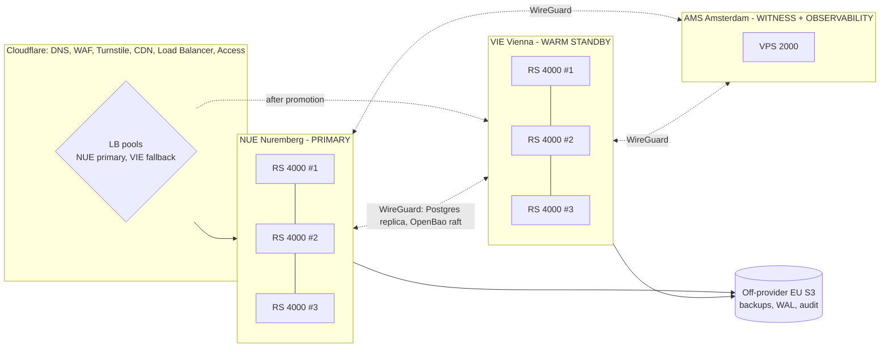

# Infrastructure, Deployment and Operations Architecture

> Version 1.0 · Hosting decision: self-managed on **netcup** (ADR-0011). Everything here is code in `nearpay-infra` (hosts, edge) and `nearpay-deploy` (workloads).

## 1. Sites and failure domains

| Site | Hosts | Role |
|---|---|---|
| **NUE** | 3 × Root Server RS 4000 G12.5 (12 dedicated EPYC cores, 32 GB, 512 GB NVMe) | k3s HA control plane + all workloads; Postgres primary + sync replica + async replica; NATS ×3; OpenBao ×2 |
| **VIE** | 3 × RS 4000 G12.5 | k3s HA; CNPG **replica cluster** (streaming from NUE); services deployed at min replicas in standby mode; NATS ×3 (idle); OpenBao ×2 |
| **AMS** | 1 × VPS 2000 G12 | OpenBao witness (5th Raft voter), observability stack, external synthetic probes, WireGuard hub for admin access |
| **Staging** | 1 × VPS 4000 G12 (NUE) | Single-node k3s; sandbox rail + tiny-mainnet canaries |

Rationale: root servers for anything stateful or latency-critical (dedicated cores, 99.9% guarantee); VPS only where an outage is tolerable. Two EU sites ~400 km apart on the same backbone survive a DC loss; the off-provider bucket + IaC survive a netcup-wide event (RTO ≤ 8 h by rebuilding on another provider).

## 2. Network

- **Public:** each node has a public IP; nftables default-deny; `443/tcp` accepted only from Cloudflare ranges with **Authenticated Origin Pulls** (mTLS); WireGuard UDP only from peer IPs; **no public SSH** (admin via WireGuard hub in AMS + hardware-key SSH certificates).
- **Private in-site:** netcup Cloud VLAN (same-location only); host firewall rules apply because the netcup firewall cannot filter VLAN traffic.
- **Cross-site:** WireGuard full mesh NUE–VIE–AMS (Postgres streaming, OpenBao Raft, metrics/logs shipping).
- **Pod network:** Cilium (eBPF) with transparent WireGuard encryption and default-deny `CiliumNetworkPolicy` per service (only edges declared in HLD §5 are allowed).
- **Egress:** webhooks via a dedicated egress-proxy deployment pinned to nodes whose IPs are published — **both NUE and VIE IPs are published** so merchant allow-lists survive failover; other egress (1Click, RPCs, vendors) through an allow-listed egress gateway.

## 3. Platform components (per site)

| Component | Choice | Notes |
|---|---|---|
| Orchestrator | **k3s** (embedded etcd, 3 servers) | Lightweight, single binary, fits root servers; no nested virtualisation needed |
| Ingress | **Traefik** (hostNetwork on all 3 nodes) | Cloudflare LB targets all node IPs → no floating IP required |
| Postgres | **CloudNativePG** | 1 primary + 1 sync + 1 async per site; `synchronous_commit = remote_apply` in-site; VIE as replica cluster; barman-cloud WAL archive to S3 |
| Events | **NATS JetStream** | 3 nodes, R3 streams, 7-day retention |
| Cache | **Valkey** | Primary + replica + Sentinel; ephemeral |
| Secrets | **OpenBao** | 5-voter Raft across NUE(2)/VIE(2)/AMS(1); Shamir 3-of-5 unseal; KV for service secrets and signing keys (loaded at pod start-up), transit only for envelope-encryption KEKs — never on the request hot path |
| GitOps | **Argo CD** + **Argo Rollouts** | Canary 10% → 50% → 100% gated on SLIs |
| Registry cache | **Zot** pull-through cache | Survives GHCR outages; images verified by cosign policy (Kyverno) |
| Policy | **Kyverno** | Signed images only, no privileged pods, resource limits required |
| Time | chrony (NTS) | Deadlines and signatures depend on time |

## 4. Data protection and DR

| Mechanism | Target |
|---|---|
| In-site sync replica (CNPG, quorum commit) | RPO 0 for single-node loss; automatic failover ≈ 30 s |
| VIE replica cluster (async over WireGuard) | RPO ≤ 60 s for site loss; manual promotion (runbook RB-02) RTO ≤ 30 min |
| WAL archive + daily base backup to off-provider S3 (35 days, encrypted, object-lock on audit bucket) | PITR anywhere in 35 days; provider-loss RTO ≤ 8 h |
| OpenBao Raft snapshots (hourly) → S3 | Secrets recoverable without quorum |
| **Weekly automated restore drill** into staging + ledger checksum comparison | Backups proven, not assumed |

**Failover safety:** each site's deep health check (`/healthz/deep`) is green only if *its* Postgres is writable. Thresholds are set so an in-site CNPG failover (≈ 30 s) never flips the LB: probe every 15 s, unhealthy after 4 consecutive failures (60 s); NUE is also the LB fallback pool, so if both pools look unhealthy traffic still goes to NUE. The Cloudflare LB therefore sends traffic to VIE automatically **only after** VIE has been promoted, and stops sending to NUE if NUE is demoted. Promotion runbook fences NUE first (stop CNPG primary, revoke NUE WireGuard peer for Postgres) to prevent split-brain.

**Why NearPay outages are safe for money:** in-flight swaps are executed by NEAR Intents, not NearPay. On recovery, trackers resume from the persisted Explorer cursor minus a 30-minute overlap and re-poll every non-terminal execution; the outbox republishes anything not yet acknowledged; consumers dedupe by event ID.

## 5. External dependencies and redundancy

| Dependency | Redundancy |
|---|---|
| NEAR block data (indexer) | Two independent finalized-block sources (FastNEAR `neardata` stream and NEAR Lake), de-duplicated by block hash; RPC catch-up as a third path |
| NEAR RPC | Pool of ≥ 3 providers with health scoring and hedged reads; self-hosted RPC node on a dedicated root server when traffic justifies (SP-13) |
| Chain RPCs (verifiers) | ≥ 2 providers per Tier-A chain family; results must agree for amounts ≥ USD 10k |
| 1Click / Explorer | Single provider (R-01); circuit breakers; direct-intents path for Intents-native payments |
| Email | Primary + fallback transactional provider |
| Screening / KYB vendors | Single each; fail policy per §13 of HLD |
| Cloudflare | Single edge (accepted R-05); status page hosted outside Cloudflare and netcup |
| GitHub / GHCR | Zot cache; deploys pause, runtime unaffected |

## 6. Environments and delivery

| Env | Rails | Data | Deploy trigger |
|---|---|---|---|
| `local` | sandbox | ephemeral (testbed compose) | developer / agent |
| `staging` | sandbox + mainnet canaries (≤ USD 5) | synthetic | merge to `main` (auto) |
| `production` | 1Click mainnet (live) + sandbox (test mode) | real | PR to `nearpay-deploy` approved by a human |

**Schema changes** follow expand → migrate → contract across at least two releases; migrations run as a pre-sync Argo hook with a separate DB role and must be backward compatible with the previous release (canaries run old and new code side by side).

Pipeline per service repo: lint → typecheck → unit → property tests on state machines → contract tests vs `nearpay-spec` → build image → SBOM (syft) → scan (grype, fail on critical) → cosign sign (keyless, GitHub OIDC) → push GHCR → bot PR to `nearpay-deploy` (staging overlay) → testbed E2E on staging → promotion PR (production overlay) → Argo Rollouts canary.

## 7. Observability

- **Instrumentation:** OpenTelemetry SDK in every service (`@nearpay/service` sets it up); trace context propagated through HTTP, NATS headers and outbox rows.
- **Backends (AMS):** VictoriaMetrics, Loki, Tempo, Grafana, Alertmanager. Placed outside NUE/VIE so they observe failures of either. A dead-man's-switch heartbeat to an external SaaS alerts if AMS itself goes dark.
- **Paging:** Alertmanager → external on-call SaaS (SMS/push), with severity routing.
- **Synthetic:** checkout journey every minute from 3 regions (external), API probes, mainnet canary payments (funds circulate between NearPay-owned canary wallets; cost = route fees, hard daily cap) every 15 min across: NEAR USDC → Base USDC, Base USDC → NEAR Intents, Solana USDC → Arbitrum USDT, BTC → USDC (hourly, cost-bounded).
- **Status page:** `status.nearpay.money` on an external provider; components map 1:1 to SLOs plus "Upstream: NEAR Intents".
