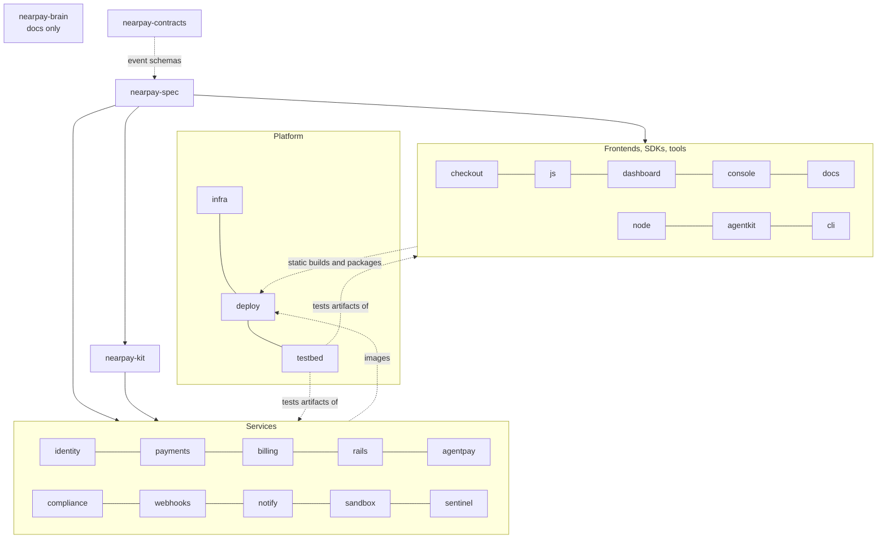

# Repository Topology

> Version 1.0 · Decision: ADR-0001 (polyrepo by bounded context, contract-first). GitHub org: `nearpay-money`. All repos are siblings under one parent folder so relative links like `../nearpay-brain` work locally.

## 1. Why this split (first principles)

A repo boundary is worth its overhead only when it buys one of: **independent deployment**, **independent publication** (package/contract with its own semver), **a security boundary** (different reviewers or credentials), or **a different toolchain**. Every repo below is justified by at least one of these; anything that failed the test was merged.

| Principle | Consequence |
|---|---|
| One bounded context → one repo → one database | Teams/agents can change a service without coordinating schema changes. |
| Contracts before code | `nearpay-spec` is the only place request/response/event/error shapes are defined; code is generated from it. |
| Depend on artifacts, never on source | Repos consume `@nearpay/*` packages, images and charts at pinned versions. No git submodules, no cross-repo relative imports. |
| Security-critical code gets its own repo | `nearpay-sentinel` (independent co-signer and auditor), `nearpay-contracts` (on-chain), `nearpay-checkout` (deposit-address display), `nearpay-deploy`/`nearpay-infra` (production access) each have distinct CODEOWNERS and credentials. |
| Docs live in one place | `nearpay-brain` holds architecture, ADRs, flows, runbooks; repos hold only README + AGENTS.md pointing there. |
| AI-agent friendly | Each repo is small enough to fit an agent's working context, builds and tests in isolation, and declares its rules in `AGENTS.md`. |

**Rejected alternatives:** a single monorepo (rejected by product owner and by the security-boundary principle); one repo per micro-concern, e.g. separate repos for hot-poller vs. explorer-feed (fails the deployment/publication test — they are process types of `nearpay-rails`).

## 2. Dependency rules



- Arrows mean "consumes a published artifact of". Cycles are forbidden.
- Services talk at runtime only through APIs/events defined in `nearpay-spec` (allowed call edges: HLD §5; enforced by Cilium policies).
- `nearpay-kit` contains no domain logic; if two services need the same domain rule, one service owns it and exposes it.

## 3. Release artifacts and naming

| Artifact | Naming | Registry |
|---|---|---|
| Service image | `ghcr.io/nearpay-money/<service>@sha256:…` | GHCR (+ Zot cache in-cluster) |
| Public npm packages | `@nearpay/js`, `@nearpay/react`, `@nearpay/node`, `@nearpay/x402`, `@nearpay/mcp`, `@nearpay/agent-signer`, `@nearpay/cli`, `@nearpay/spec` | npm (⚠ scope availability: Q-BIZ-03) |
| Internal npm packages | `@nearpay-internal/*` | GitHub Packages (private) |
| Contracts | `v<N>.vault.nearpay.near` (immutable per version) | NEAR mainnet |
| Hosts | `api.`, `pay.`, `js.`, `dashboard.`, `ops.`, `docs.`, `status.` + apex `nearpay.money` | Cloudflare DNS |

## 4. Catalogue


| # | Repo | Group | Kind | Ships as | Phase |
|---|---|---|---|---|---|
| 0 | `nearpay-brain` | Knowledge | docs | — | always |
| 1 | `nearpay-spec` | Contracts & shared | spec | npm: @nearpay/spec (public), @nearpay-internal/spec (private) | P0 Foundations |
| 2 | `nearpay-kit` | Contracts & shared | library | npm (private): @nearpay-internal/{money,ids,service,db,auth,intents,chains,testing} | P0 Foundations |
| 3 | `nearpay-identity` | Services | service | image: ghcr.io/nearpay-money/identity · routes /v1/account, /v1/settlement_destinations, /v1/api_keys, /authz | P0 Foundations |
| 4 | `nearpay-payments` | Services | service | image: ghcr.io/nearpay-money/payments · routes /v1/checkout, /v1/payment_intents, /v1/refunds, /v1/payment_links, /v1/customers, /v1/balance_transactions | P1 Core payments |
| 5 | `nearpay-billing` | Services | service | image: ghcr.io/nearpay-money/billing · routes /v1/products, /v1/prices, /v1/invoices, /v1/subscriptions, /v1/mandates | P2 Refunds, billing, agents |
| 6 | `nearpay-rails` | Services | service | image: ghcr.io/nearpay-money/rails · routes /v1/assets; internal /executions, /quotes | P1 Core payments |
| 7 | `nearpay-agentpay` | Services | service | image: ghcr.io/nearpay-money/agentpay · routes /x402/*, /v1/checkout/sessions/{id}/agent_pay | P2 Refunds, billing, agents |
| 8 | `nearpay-compliance` | Services | service | image: ghcr.io/nearpay-money/compliance · internal only | P1 Core payments |
| 9 | `nearpay-webhooks` | Services | service | image: ghcr.io/nearpay-money/webhooks · routes /v1/events, /v1/webhook_endpoints, /v1/webhook_signing_keys | P1 Core payments |
| 10 | `nearpay-notify` | Services | service | image: ghcr.io/nearpay-money/notify · internal only | P1 Core payments |
| 11 | `nearpay-sandbox` | Services | service | image: ghcr.io/nearpay-money/sandbox · internal only (test-mode rail) | P0 Foundations |
| 12 | `nearpay-sentinel` | Services | service | image: ghcr.io/nearpay-money/sentinel · route /v1/attestations/deposit_instructions; separate credentials | P1 Core payments |
| 13 | `nearpay-checkout` | Frontends | static SPA | pay.nearpay.money | P1 Core payments |
| 14 | `nearpay-js` | Frontends | library + static | js.nearpay.money/v1/nearpay.js · npm: @nearpay/js, @nearpay/react | P1 Core payments |
| 15 | `nearpay-dashboard` | Frontends | static SPA | dashboard.nearpay.money | P1 Core payments |
| 16 | `nearpay-console` | Frontends | static SPA (internal) | ops.nearpay.money behind Cloudflare Access | P1 Core payments |
| 17 | `nearpay-docs` | Frontends | static site | docs.nearpay.money | P1 Core payments |
| 18 | `nearpay-web` | Frontends | static site | nearpay.money | P1 Core payments |
| 19 | `nearpay-node` | SDKs & tools | library | npm: @nearpay/node | P1 Core payments |
| 20 | `nearpay-agentkit` | SDKs & tools | library | npm: @nearpay/x402, @nearpay/mcp, @nearpay/agent-signer | P2 Refunds, billing, agents |
| 21 | `nearpay-cli` | SDKs & tools | binary | npm: @nearpay/cli + standalone binaries | P3 Auto-debit and hardening |
| 22 | `nearpay-contracts` | On-chain | Rust / NEAR | accounts: v1.vault.nearpay.near (immutable) | P3 Auto-debit and hardening |
| 23 | `nearpay-infra` | Platform | IaC | netcup hosts, Cloudflare, GitHub org, object storage | P0 Foundations |
| 24 | `nearpay-deploy` | Platform | GitOps | Argo CD source of truth | P0 Foundations |
| 25 | `nearpay-testbed` | Platform | tests | CI + scheduled jobs | P0 Foundations |


## 5. Directory structures

Each repo additionally contains `README.md`, `AGENTS.md` and `.github/CODEOWNERS` (money-critical paths need two human approvals — T-15).

### nearpay-brain

```
nearpay-brain/
├── README.md
├── AGENTS.md
├── product/        brief, requirements
├── architecture/   hld, domain-model, flows, api-conventions, security, infrastructure, repositories
├── decisions/      ADR-0000…ADR-0014
├── quality/        stress-test, capacity, risks
├── operations/     slos, runbooks
├── roadmap/        roadmap, open-questions
└── reference/      landscape, glossary
```

### nearpay-spec

Single source of truth for every contract: public REST (OpenAPI 3.1), internal service APIs, domain events (AsyncAPI), webhook payloads, error catalogue, NearPay x402 scheme.

```
nearpay-spec/
├── asyncapi/
│   └── events/
├── codegen/
├── errors/
├── openapi/
│   ├── internal/
│   └── public/
├── packages/
│   ├── spec-internal/
│   └── spec-public/
├── schemas/
│   ├── webhooks/
│   └── x402/
├── test/
│   └── compat/
└── .github/
    └── workflows/
```

### nearpay-kit

Small, versioned TypeScript runtime libraries shared by services: integer money, IDs, service bootstrap (Fastify + OpenTelemetry), Postgres helpers (outbox, inbox, idempotency), internal auth, NEAR Intents payload build/sign/verify, chain address validation, test utilities.

```
nearpay-kit/
├── packages/
│   ├── auth/
│   ├── chains/
│   ├── db/
│   ├── ids/
│   ├── intents/
│   ├── money/
│   ├── service/
│   └── testing/
└── .github/
    └── workflows/
```

### nearpay-identity

Accounts, users, roles, passkey sessions, API keys, settlement destinations with attestation and cool-off, gateway authorisation.

```
nearpay-identity/
├── migrations/
├── src/
│   ├── api/
│   ├── app/
│   ├── consumers/
│   ├── domain/
│   │   ├── account/
│   │   ├── api-key/
│   │   ├── approval/
│   │   ├── authz/
│   │   ├── passkey/
│   │   ├── session/
│   │   ├── settlement-destination/
│   │   └── user/
│   ├── infra/
│   │   ├── bus/
│   │   ├── clients/
│   │   └── db/
│   └── workers/
├── test/
│   ├── contract/
│   ├── integration/
│   ├── property/
│   └── unit/
└── .github/
    └── workflows/
```

### nearpay-payments

Payment lifecycle: checkout sessions, payment intents, attempts, refunds, payment links, customers, statement ledger, reconciliation.

```
nearpay-payments/
├── migrations/
├── src/
│   ├── api/
│   ├── app/
│   ├── consumers/
│   ├── domain/
│   │   ├── checkout-session/
│   │   ├── customer/
│   │   ├── payment-attempt/
│   │   ├── payment-intent/
│   │   ├── payment-link/
│   │   ├── refund/
│   │   └── statement/
│   ├── infra/
│   │   ├── bus/
│   │   ├── clients/
│   │   └── db/
│   ├── sse/
│   └── workers/
├── test/
│   ├── contract/
│   ├── integration/
│   ├── property/
│   └── unit/
└── .github/
    └── workflows/
```

### nearpay-billing

Products, prices, manual tax rates, invoices, subscriptions, dunning, and the vault keeper for auto-debit mandates. A client of payments.

```
nearpay-billing/
├── migrations/
├── src/
│   ├── api/
│   ├── app/
│   ├── consumers/
│   ├── domain/
│   │   ├── dunning/
│   │   ├── invoice/
│   │   ├── mandate/
│   │   ├── price/
│   │   ├── product/
│   │   ├── subscription/
│   │   └── tax-rate/
│   ├── infra/
│   │   ├── bus/
│   │   ├── clients/
│   │   └── db/
│   ├── keeper/
│   ├── scheduler/
│   └── workers/
├── templates/
│   └── invoice-pdf/
├── test/
│   ├── contract/
│   ├── integration/
│   ├── property/
│   └── unit/
└── .github/
    └── workflows/
```

### nearpay-rails

Value movement: route providers (1Click, sandbox, direct-intents), token registry, pricing/FX, executions, tracking (hot poller, Explorer feed, NEAR indexer, destination watchers with amount tags), Tier-A chain verifiers.

```
nearpay-rails/
├── migrations/
├── src/
│   ├── api/
│   ├── app/
│   ├── consumers/
│   ├── domain/
│   │   ├── execution/
│   │   ├── pricing/
│   │   ├── token-registry/
│   │   └── verification/
│   ├── infra/
│   │   ├── bus/
│   │   ├── clients/
│   │   └── db/
│   ├── providers/
│   │   ├── direct-intents/
│   │   ├── oneclick/
│   │   └── sandbox/
│   ├── trackers/
│   │   ├── destination-watchers/
│   │   ├── explorer-feed/
│   │   ├── hot-poller/
│   │   └── near-indexer/
│   ├── verifiers/
│   │   ├── bitcoin/
│   │   ├── evm/
│   │   ├── near/
│   │   └── solana/
│   └── workers/
├── test/
│   ├── contract/
│   ├── fixtures/
│   │   └── oneclick/
│   ├── integration/
│   ├── property/
│   └── unit/
└── .github/
    └── workflows/
```

### nearpay-agentpay

x402 v2 facilitator (exact: intents-transfer, near-intents), MPP adapter, batching relayer for signed NEAR Intents with a function-call key pool.

```
nearpay-agentpay/
├── migrations/
├── src/
│   ├── api/
│   ├── app/
│   ├── consumers/
│   ├── domain/
│   │   ├── binding/
│   │   ├── facilitator-payment/
│   │   └── relay-batch/
│   ├── infra/
│   │   ├── bus/
│   │   ├── clients/
│   │   └── db/
│   ├── mpp/
│   ├── relayer/
│   │   ├── batcher/
│   │   └── key-pool/
│   ├── workers/
│   └── x402/
│       └── schemes/
│           ├── intents-transfer/
│           └── near-intents/
├── test/
│   ├── contract/
│   ├── integration/
│   ├── property/
│   └── unit/
└── .github/
    └── workflows/
```

### nearpay-compliance

Address screening, KYB cases, geo policy, compliance cases and blocklists; policies are data per jurisdiction.

```
nearpay-compliance/
├── migrations/
├── policies/
├── src/
│   ├── api/
│   ├── app/
│   ├── consumers/
│   ├── domain/
│   │   ├── blocklist/
│   │   ├── case/
│   │   ├── geo-policy/
│   │   ├── kyb-case/
│   │   └── screening/
│   ├── infra/
│   │   ├── bus/
│   │   ├── clients/
│   │   └── db/
│   ├── vendors/
│   │   ├── kyb/
│   │   └── screening/
│   └── workers/
├── test/
│   ├── contract/
│   ├── integration/
│   ├── property/
│   └── unit/
└── .github/
    └── workflows/
```

### nearpay-webhooks

Public event log, webhook endpoints, signed delivery with retries, replay and delivery logs.

```
nearpay-webhooks/
├── migrations/
├── src/
│   ├── api/
│   ├── app/
│   ├── consumers/
│   ├── dispatcher/
│   ├── domain/
│   │   ├── delivery/
│   │   ├── endpoint/
│   │   └── event/
│   ├── infra/
│   │   ├── bus/
│   │   ├── clients/
│   │   └── db/
│   ├── signing/
│   └── workers/
├── test/
│   ├── contract/
│   ├── integration/
│   ├── property/
│   └── unit/
└── .github/
    └── workflows/
```

### nearpay-notify

Transactional email (receipts, invoices, dunning, security alerts) with primary/fallback providers.

```
nearpay-notify/
├── migrations/
├── src/
│   ├── api/
│   ├── app/
│   ├── consumers/
│   ├── domain/
│   │   ├── message/
│   │   └── template/
│   ├── infra/
│   │   ├── bus/
│   │   ├── clients/
│   │   └── db/
│   ├── providers/
│   │   ├── fallback/
│   │   └── primary/
│   └── workers/
├── templates/
│   └── email/
├── test/
│   ├── contract/
│   ├── integration/
│   ├── property/
│   └── unit/
└── .github/
    └── workflows/
```

### nearpay-sandbox

Deterministic simulator of the route provider and chains for test mode, local development and E2E (NEAR Intents has no testnet).

```
nearpay-sandbox/
├── src/
│   ├── api/
│   ├── scenarios/
│   ├── simulated-chains/
│   └── test-helpers/
├── test/
│   ├── scenario/
│   └── unit/
└── .github/
    └── workflows/
```

### nearpay-sentinel

Independent second party with its own code, credentials and deploy pipeline: co-signs every deposit instruction shown by checkout after re-reading the quote from 1Click and matching it to an active destination in identity's registry; independently re-reconciles succeeded payments against chain evidence; owns the global quoting kill switch.

```
nearpay-sentinel/
├── src/
│   ├── address-integrity/
│   ├── co-signer/
│   ├── independent-reconciliation/
│   └── kill-switch/
├── test/
│   ├── integration/
│   └── unit/
└── .github/
    └── workflows/
```

### nearpay-checkout

Hosted checkout, payment links, hosted invoices and the embedded iframe app; wallet adapters; deposit instructions; live status.

```
nearpay-checkout/
├── public/
├── src/
│   ├── features/
│   │   ├── asset-picker/
│   │   ├── deposit-instructions/
│   │   ├── refund-address/
│   │   ├── status-stream/
│   │   └── wallet-connect/
│   ├── lib/
│   │   ├── api/
│   │   └── integrity/
│   ├── routes/
│   │   ├── embed/
│   │   ├── invoice/
│   │   ├── payment-link/
│   │   └── session/
│   └── wallets/
│       ├── evm/
│       ├── near/
│       └── solana/
├── test/
│   ├── e2e/
│   └── unit/
└── .github/
    └── workflows/
```

### nearpay-js

Widget loader and client SDKs that mount the checkout iframe and speak a versioned postMessage protocol.

```
nearpay-js/
├── examples/
│   ├── html/
│   └── react/
├── packages/
│   ├── js/
│   ├── loader/
│   └── react/
├── protocol/
├── test/
└── .github/
    └── workflows/
```

### nearpay-dashboard

Merchant dashboard: payments, refunds (with wallet signing), invoices, subscriptions, customers, developers (keys, webhooks, events, logs), settlement, team.

```
nearpay-dashboard/
├── src/
│   ├── features/
│   │   ├── customers/
│   │   ├── developers/
│   │   ├── invoices/
│   │   ├── payments/
│   │   ├── refunds/
│   │   ├── settings/
│   │   ├── settlement/
│   │   ├── subscriptions/
│   │   └── team/
│   ├── lib/
│   ├── routes/
│   └── wallets/
├── test/
│   ├── e2e/
│   └── unit/
└── .github/
    └── workflows/
```

### nearpay-console

Internal operations: merchant review, KYB, compliance cases, screening hits, execution explorer, verification holds, audit log.

```
nearpay-console/
├── src/
│   ├── features/
│   │   ├── audit/
│   │   ├── cases/
│   │   ├── executions/
│   │   ├── holds/
│   │   ├── kyb/
│   │   └── merchants/
│   └── lib/
├── test/
└── .github/
    └── workflows/
```

### nearpay-docs

Public developer documentation: guides, API reference generated from nearpay-spec, webhooks, test mode, agents, error pages.

```
nearpay-docs/
├── content/
│   ├── agents/
│   ├── api/
│   ├── errors/
│   ├── guides/
│   ├── test-mode/
│   └── webhooks/
├── scripts/
├── src/
└── .github/
    └── workflows/
```

### nearpay-web

Marketing site, pricing, legal pages.

```
nearpay-web/
├── public/
├── src/
│   ├── components/
│   └── pages/
└── .github/
    └── workflows/
```

### nearpay-node

Server SDK for Node/TypeScript: typed resources, automatic idempotency keys and retries, webhook signature verification, refund signing helpers.

```
nearpay-node/
├── examples/
├── src/
│   ├── http/
│   ├── resources/
│   ├── signing/
│   └── webhooks/
├── test/
└── .github/
    └── workflows/
```

### nearpay-agentkit

Agent payments toolkit: x402 server middleware (Express/Hono/Next) and client, MCP server for agents, NEAR Intents signing helpers.

```
nearpay-agentkit/
├── examples/
│   ├── agent/
│   └── express/
├── packages/
│   ├── agent-signer/
│   ├── mcp/
│   └── x402/
├── test/
└── .github/
    └── workflows/
```

### nearpay-cli

Developer CLI: login, listen (forward webhooks to localhost), trigger test events, tail logs, resend events.

```
nearpay-cli/
├── src/
│   ├── commands/
│   └── lib/
├── test/
└── .github/
    └── workflows/
```

### nearpay-contracts

NEAR smart contracts. v1: subscription-vault (payer-funded, payer-cancellable mandates; permissionless collect).

```
nearpay-contracts/
├── audits/
├── contracts/
│   └── subscription-vault/
│       ├── src/
│       └── tests/
├── integration-tests/
├── scripts/
└── .github/
    └── workflows/
```

### nearpay-infra

Host provisioning and hardening (Ansible), WireGuard mesh, k3s install, Cloudflare/GitHub/object-storage (Terraform), cluster bootstrap (Argo CD, OpenBao).

```
nearpay-infra/
├── ansible/
│   ├── inventories/
│   │   ├── production/
│   │   └── staging/
│   └── roles/
│       ├── base-hardening/
│       ├── k3s/
│       ├── observability-host/
│       └── wireguard/
├── bootstrap/
│   ├── argocd/
│   └── openbao/
├── terraform/
│   ├── cloudflare/
│   ├── github/
│   └── object-storage/
└── .github/
    └── workflows/
```

### nearpay-deploy

Desired state of every cluster: Argo CD applications, the shared service Helm chart, platform components, per-environment overlays, SOPS-encrypted config.

```
nearpay-deploy/
├── apps/
├── charts/
│   └── nearpay-service/
├── envs/
│   ├── prod-nue/
│   ├── prod-vie/
│   └── staging/
├── platform/
│   ├── argo-rollouts/
│   ├── cilium/
│   ├── cnpg/
│   ├── egress-proxy/
│   ├── kyverno/
│   ├── nats/
│   ├── observability/
│   ├── openbao/
│   ├── traefik/
│   ├── valkey/
│   └── zot/
├── secrets/
└── .github/
    └── workflows/
```

### nearpay-testbed

Whole-system verification: local compose stack, cross-service E2E, consumer-driven contract tests, load tests (k6), chaos scenarios, mainnet canary runner, recorded provider fixtures.

```
nearpay-testbed/
├── canary/
├── chaos/
├── compose/
├── contract-tests/
├── e2e/
│   ├── agent/
│   ├── api/
│   ├── checkout/
│   └── dashboard/
├── fixtures/
│   └── oneclick/
├── load/
└── .github/
    └── workflows/
```
