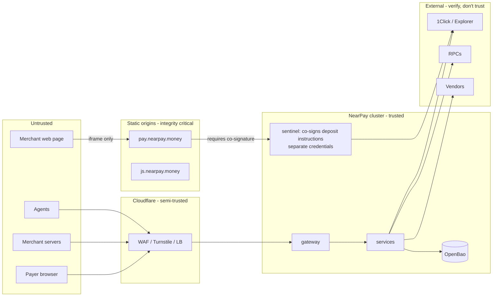

# Security Architecture and Threat Model

> Version 1.0 · Method: assets → trust boundaries → STRIDE per boundary → top threats with controls → residual risk. Re-run on every ADR touching money, keys or auth.

## 1. What we protect (ranked)

1. **Correct routing of funds** — payers' money must reach the merchant's real destination (or come back to the payer).
2. **Integrity of payment state** — merchants ship goods on our `succeeded`; a false positive is a direct loss.
3. **Merchant account control** — settlement destinations, API keys, team.
4. **Availability of checkout** — lost sales.
5. **Confidentiality** — PII, merchant business data, secrets.
6. **NearPay treasury and gas accounts.**

## 2. Trust boundaries

## 3. Key and secret inventory

> **v1 (ADR-0015):** wherever this table says OpenBao, v1 stores the secret as a SOPS-encrypted file decrypted into a per-service Docker secret; envelope-encryption KEKs are per-service files. Rotation procedures are the same.

| Key / secret | Where | Power if stolen | Control |
|---|---|---|---|
| Treasury (`treasury.nearpay.near`) | Hardware wallets, 2-of-3 multisig | Steal accumulated fees | Offline signers, withdrawal runbook, alerts on any outgoing tx |
| Relayer keys (agentpay, rails) | OpenBao; loaded in memory | Submit already-signed intents; burn gas allowance | NEAR **function-call keys** limited to `intents.near::execute_intents`, allowance-capped; pool rotated monthly |
| Keeper key (vault `collect`) | OpenBao | Trigger collections that are anyway permissionless | Function-call key limited to vault `collect` |
| `nearpay.near` root | Hardware wallet, offline | Create/delete sub-accounts | Used only for account management ceremonies |
| 1Click partner JWT | OpenBao | Quote in our name; fee attribution | Rails-only; rotation; anomaly alerts on quote volume |
| Webhook endpoint secrets | DB, envelope-encrypted (KEK in OpenBao transit) | Forge webhooks to that merchant | Per endpoint; rotate with overlap |
| Ed25519 webhook signing key | OpenBao (KV), loaded into `webhooks` memory at start-up | Forge webhooks to all | Quarterly rotation with JWKS overlap; only `webhooks` pods may read it |
| Internal JWT signing key | OpenBao (KV), loaded into `identity` memory | Impersonate any merchant internally | Daily rotation; 60 s tokens; audience-scoped; Cilium limits who can call whom |
| Sentinel co-signing key (Ed25519) | OpenBao (KV, sentinel-only policy), in sentinel memory | Make checkout display an attacker address **only if** the API tier is also compromised | Separate OpenBao policy, deploy pipeline and CODEOWNERS; public key pinned in checkout build; rotation = new checkout release |
| API keys (merchant) | Merchant side; NearPay stores SHA-256 | Act as merchant (cannot change destinations) | Scopes, restricted keys, optional IP allowlist, GitHub secret-scanning partner pattern `sk_live_` |
| PII key-encryption key (KEK) | OpenBao transit (non-exportable); data keys wrapped by it, cached ≤ 1 h in service memory | Read PII from a DB dump | KEK never leaves OpenBao; DEK rotation monthly |

**Property (INV-1):** no row in this table except Treasury can move user or merchant funds; treasury only holds NearPay's own fees.

## 4. Top threats and controls

| ID | Threat (STRIDE) | Controls | Residual |
|---|---|---|---|
| **T-01** | Account takeover → attacker swaps settlement destination (S, E) | Passkeys; step-up on change; destination wallet attestation; 2-approver rule; 24 h cool-off; notify all owners + destination fingerprint shown in every receipt; API keys cannot touch destinations | Low |
| **T-02** | Malicious script on merchant page swaps displayed deposit address (T) | Address only rendered inside `pay.nearpay.money` iframe; loader served with SRI and versioned immutable URLs; CSP `frame-ancestors` allow-list per account (optional); wallet-connect path builds the tx inside the iframe | Low |
| **T-03** | Compromised `payments`/`rails` tier issues quotes to an attacker recipient (T, E) | `recipient` originates only in identity; rails asserts equality; **sentinel co-signs every deposit instruction** after independently re-reading the quote from 1Click and matching it to an *active destination in identity's registry* (read-only replica role) — checkout refuses to render an address without a valid co-signature (pinned key); separate pipeline for checkout; ⚠ client-side 1Click signature verification (SP-01) | Low (requires identity compromise **and** bypass of attestation/cool-off/notifications) |
| **T-04** | False `succeeded` (spoofed provider response, bug) (T) | Evidence-before-success (Tier A on-chain verification), observation hashing, verifier holds page on-call, Tier B limits, daily reconciliation | Low |
| **T-05** | Webhook forgery / replay to merchant (S) | HMAC + Ed25519, timestamp tolerance, event IDs, SDK raw-body verification | Low |
| **T-06** | SSRF via webhook URL (I, E) | Egress proxy denying RFC1918/link-local/metadata, DNS pin, no redirects, separate network namespace | Low |
| **T-07** | Agent payment replay / reuse for another resource (S, T) | Verifier nonces; `memo = binding` (hash of requirement + resource URL + merchant); deadline ≤ `maxTimeoutSeconds` | Low |
| **T-08** | Quote/attempt flooding to exhaust 1Click quota (D) | Turnstile before live quotes; per-session/IP/merchant limits; indicative pricing without quotes; cost alarms | Low |
| **T-09** | Price oracle manipulation / stablecoin depeg (T) | Dual-source deviation check; depeg guard; snapshot per attempt; quote validity bound | Low |
| **T-10** | Vault contract bug drains mandates (T, E) | Minimal code, no admin fund methods, no access keys, per-mandate and global caps, two independent audits, property tests + fuzzing, bug bounty | Medium (inherent) |
| **T-11** | Supply-chain compromise of checkout/widget (T) | Pinned lockfiles, `npm ci --ignore-scripts`, provenance, reproducible static build, SRI, no runtime third-party scripts except Turnstile + bundled wallet SDKs, separate deploy credentials | Medium |
| **T-12** | Insider / ops abuse (E, R) | Console behind Cloudflare Access + hardware keys; RBAC; two-person rule for merchant suspension/unsuspension; immutable audit log shipped to object-locked storage | Low |
| **T-13** | DB exfiltration (I) | PII field encryption; secrets hashed/encrypted; backups encrypted; least-privilege roles per service | Low |
| **T-14** | Sanctioned funds through platform (compliance) | Pre-screening, post-screening, geo policy, KYB, case management | Medium (non-custodial cannot block in-flight) |
| **T-15** | AI coding agent introduces unsafe change in money path (T) | CODEOWNERS: human review required for `**/money/**`, state machines, migrations, contracts, auth; invariant property tests in CI; protected branches; agents have no prod credentials; deploys via GitOps PR | Low |
| **T-16** | Relayer/gas account drained by spam (D) | Function-call allowance caps; per-merchant facilitator quotas; auto top-up with daily ceiling; alerting | Low |

## 5. Application security baseline

- OWASP ASVS L2; dependency and container scanning in CI; secrets scanning on all repos.
- CSP on all SPAs (no `unsafe-inline`; nonces), `Strict-Transport-Security` preload, `X-Frame-Options` except checkout's controlled `frame-ancestors`.
- Input validation from spec-generated validators at every service boundary (zod), output encoding in SPAs.
- Database: least-privilege role per service; migrations by a separate role; row-level `account_id` filters in repository layer; `livemode` mandatory predicate (INV-8).
- Audit log: every admin/ops/sensitive merchant action → `audit_events` (append-only) → shipped hourly to object-locked storage.

## 6. Incident response hooks

| Trigger | Automatic action |
|---|---|
| Sentinel refuses to co-sign (mismatch) | Halt live quoting globally (`rails.quoting_enabled = false`), page on-call, freeze destination changes |
| Verifier hold rate > 1% in 15 min | Page; pause Tier-B routes |
| Destination changes spike | Rate-limit destination changes platform-wide, page |
| Relayer allowance < 20% | Top-up within ceiling, page if ceiling hit |
| Treasury outgoing tx | Notify all signers |
