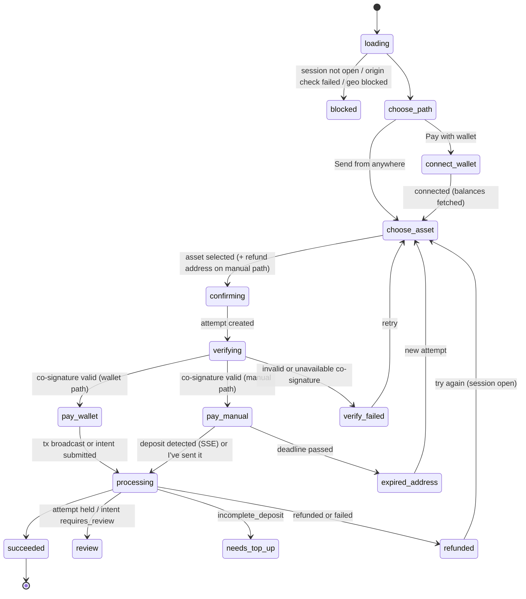

# LLD — `nearpay-checkout` and `nearpay-js`

> Version 1.8 (step 4.3 Phase A: hosted invoice auto-pay §4.4; Solana implementation decisions §11.1) · Version 1.7 (step 4.1, spec 0.4.0: Solana wallet path — wallet standard, SOL and SPL transfer recipes from the attestation, no memo/reference — and Solana Pay / BIP-21 manual-path QR, §11) · Version 1.6 (step 3.3, spec 0.3.0 + `@nearpay-internal/ui` 0.3.0: hosted invoices §4.3, spec 0.2.1 fields adopted §"Spec 0.2.1 contract changes", lazy invoice chunk §7) · Spec 0.2.1 update (spec 0.2.1: fee breakdown, amount received, pricing-asset display, attested token contract — §"Spec 0.2.1 contract changes") · Version 1.5 (step 2.3, spec 0.2.0 + `@nearpay-internal/ui` 0.2.0: UI on the design system and the Figma checkout canvas §4.1, `change` / `use_manual` transitions §4, payment links §4.2, `PaymentOption.token` and `Attestation.asset` §5.2/§5.4, footer links §2) · Version 1.4 (step 1.4, spec 0.1.5: tolerant response parsing §3, `np:complete` from `PublicCheckoutSession.payment_intent` §6) · Version 1.3 (step 1.3 implementation findings folded: build constants and CSP §2, UI states §4, rules §5, protocol and API §6, i18n and budget §7, tests §8, open items §10) · Version 1.1 audited (`audits/checkout-and-js.md`) · ADR-0010 · Flows §2–§3 · FR-PAY-03, FR-PAY-06, FR-PAY-10 · Foundations `00-foundations.md`

## 1. Scope

**checkout** (static SPA, `pay.nearpay.<tld>`): hosted checkout `/c/:id`, embedded `/embed/:id`, payment links `/l/:id`, hosted invoices `/i/:id` (Stage 3); wallet connection; asset choice; deposit instructions; Intents-transfer signing; live status; sentinel verification.
**js** (`js.nearpay.<tld>/v1/nearpay.js` + `@nearpay/js` + `@nearpay/react`): mounts the embedded checkout iframe and speaks the postMessage protocol.

## 2. Build and hosting

Vite build → hashed assets; `index.html` with strict CSP; served by nginx behind Traefik (local; `frame-ancestors` is sent as a header per route, since a meta CSP cannot carry it) / Cloudflare (server stage). Build-time constants:
- `VITE_API_ORIGIN` — default the relative `/api` (the API is reached same-origin through the gateway, so there is no CORS, and one build serves any domain); an absolute https origin is still accepted and added to `connect-src`.
- `VITE_SENTINEL_KEYS` (JSON `[{kid, public_key}]` — **pinned**) — falls back to the file named by `NP_SENTINEL_KEYS_FILE`, then `../nearpay-deploy/.secrets/public/sentinel_keys.json` (written by `seed.sh keys`); a production build without keys **fails**. The E2E build (`--mode e2e` → `dist-e2e/`) pins the spec test-vector key instead, so `dist/` never carries test keys.
- `VITE_TURNSTILE_SITEKEY` — defaults to Cloudflare's always-pass test sitekey (pairs with the local test secret); production builds must set it.
- `VITE_NEAR_RPC_URL` (default `https://free.rpc.fastnear.com`) — the wallet path needs NEAR view calls (`storage_balance_of`, `storage_balance_bounds`, Verifier `current_salt`).
- `VITE_WALLETCONNECT_PROJECT_ID` (reserved; WalletConnect is not built in Stage 1, §10), `VITE_NEAR_NETWORK`.
- `VITE_WEB_URL` (default `https://nearpay.money`) — hosted footer links Help (`/support`), Privacy, Terms; the embedded card shows no footer links.

**CSP nonce on a static site:** `index.html` carries `'nonce-{{NP_CSP_NONCE}}'` in the meta CSP and `<meta name="np-csp-nonce">`; nginx replaces the placeholder with the per-response `$request_id` (`sub_filter`, pay `/` and `/embed/`; platform §1). NEAR Connect runs wallet executors in `srcdoc` frames that inherit the page CSP, so it cannot work without a real per-response nonce; its popup `<style>` elements are re-inserted with the nonce. Unsubstituted, the placeholder is an invalid CSP source: the policy stays strict and NEAR wallets are disabled.

**CSP (hosted):** `default-src 'none'; script-src 'self' 'nonce-…' https://challenges.cloudflare.com; style-src 'self' 'nonce-…'; img-src 'self' data:; font-src 'self'; connect-src 'self' <absolute API origin, if any> <NEAR RPC> https://raw.githubusercontent.com (NEAR Connect executors, commit-pinned and SRI-checked; §10); frame-src https://challenges.cloudflare.com; base-uri 'none'; form-action 'none'; object-src 'none'` + header `frame-ancestors 'none'`. `img-src` stays `'self' data:`: remote wallet icons are not shown; EIP-6963 icons must be `data:` URIs.
**CSP (embed route):** same but `frame-ancestors https:` (and `http://localhost:*` in local), plus the runtime ancestor check in §5.

## 3. Code layout

```
src/routes/session/   hosted flow       src/routes/embed/      iframe flow + protocol
src/routes/payment-link/                src/routes/invoice/    (Stage 3)
src/features/asset-picker/      options list, balances, route availability
src/features/wallet-connect/    NEAR Connect, EVM (EIP-6963 injected + WalletConnect), Solana (Stage 4)
src/features/deposit-instructions/  address, QR, memo, network guard, countdown, "I've sent it"
src/features/refund-address/    validation per chain, exchange-address warning
src/features/status-stream/     fetch-based SSE client (sends the client-secret header; `EventSource` cannot), polling fallback every 3 s
src/lib/api/                    typed client from @nearpay/spec (public payer routes only)
src/lib/integrity/              sentinel verification (JCS + Ed25519), fingerprint rendering
src/wallets/near|evm|solana/    tx builders
```
Payer responses and stream events are parsed with the spec's `safeParseTolerant` (spec 0.1.5, foundations §3): unknown open-enum values (session, intent, attempt statuses) are kept verbatim; closed enums, literals, shapes and missing required fields (e.g. `payment_intent`) fail with `invalid_response`. This replaced step 1.3's hand-rolled parse, which also let unknown closed-enum values through.

## 4. UI state machine


Step 2.3 adds two presentation transitions: `pay_wallet | verify_failed → choose_asset` on **change** (the review's "Change"; verified instructions are dropped, the next attempt hides the old one, §5.7) and `connect_wallet | choose_asset | pay_wallet → choose_asset (manual)` on **use_manual** ("Send from another wallet" on the wallet list and the desktop review). The machine also records `depositSeen` (the current attempt reached `deposit_detected…succeeded` in this page load) so a later `failed` reads "being returned" rather than "didn't complete".

`review` shows "payment received — under review, don't pay again". `confirming` is also the resume state for an attempt still `quoting`. **Resume on reload:** a live `route_quote` attempt is re-verified with sentinel and shown on the manual path; a live `intents_transfer` attempt is not resumed (the payer starts a new attempt).

### 4.1 Screens (step 2.3)

Every screen is built from `@nearpay-internal/ui` (`CheckoutFrame`, `SelectionCard`, `Callout`, `CopyField`, `Countdown`, `Modal`, …) to the owner's Figma checkout canvas; the phase → frame mapping is code (`src/app/screens.ts`, unit-tested for every phase):

| §4 phase | Figma frame(s) |
|---|---|
| loading | frame skeleton |
| blocked | "This checkout can't be used" (reason text) |
| choose_path | "Pay your way" (hosted) / "Choose how to pay" (embedded card) |
| connect_wallet | "Connect a wallet" (EIP-6963 wallets + NEAR wallet, Cancel, "Send from another wallet instead") |
| choose_asset | "Pay with" (search, "All networks" → "Choose a network", "Available for this payment", "No matching payment options" + Clear filters); manual path after a pick: "Send from another wallet" (token card + Change, refund address, "Check your sending network"); no options: "Try another wallet or currency" |
| confirming, verifying | "Verifying this checkout" |
| verify_failed | "We couldn't verify this checkout" (+ reason line) |
| pay_wallet | review (token card with Change, Purchase / Payment fees / Total to send, wallet network-fee note, Pay, "Quote refreshes in mm:ss"); desktop: two-column with the summary on the left and "You send" + "Send from another wallet" in the card; "Review your updated total" after a re-quote whose attested total changed; test mode "Try a payment" + Simulate payment; "Approve in your wallet" while the wallet request is open; "Payment not approved" (wallet rejection); "Not enough funds" (wallet/RPC balance errors, `insufficient_balance`) |
| pay_manual | "Send <amount>" (network callout, "I'm sending on <network>", memo + "I included the memo", then deposit address with copy + QR + "Expires in", exact amount, "I've sent the payment", "We confirm automatically…") |
| needs_top_up | "We received less than expected" (Expected = attested amount; the same guarded instructions for the remainder) |
| expired_address | manual: "This address has expired"; wallet: "Quote expired" ("Get a new quote" re-selects the same option and shows the updated total if it changed) |
| processing | "Waiting for your payment" (attempt still `awaiting_deposit` — no "detected" claim), "Confirming your payment" (deposit detected; while the attempt is `verifying`: "Payment received — confirming on {attested destination chain} (usually under a minute)" for Base, Arbitrum, NEAR and Solana, without the time promise for other chains — ADR-0022), "Still confirming" after 2 min (Check status: spinner while the session reloads, then "Still confirming · checked HH:MM:SS" while nothing changed) |
| review | "Payment under review" (Copy payment reference) |
| succeeded | "Payment complete" (attested amount · network when paid in this page load; Return to <merchant> on hosted) |
| refunded | `refunded` → "Your payment was returned" (refunded amount); `failed` after a detected deposit → "Payment being returned"; `expired_unpaid` → "Quote expired"; `failed` otherwise → "Try another wallet or currency" |

Header: the **attested** merchant name (after verification only; before it the frame shows amount + description, never `merchant_name_unverified`), amount hero, description. Instruction screens carry a trust row ("Business details reviewed by NearPay" or "…not reviewed", from `merchant.kyb_verified`) that opens the **Payment details** sheet: merchant, "Reviewed" badge + "Business details reviewed by NearPay" (ADR-0020: never "verified identity"), payment destination (`<symbol> · <network>`), destination fingerprint in the dashboard's `XXXX-XXXX-XX` format (the Figma's 4×4 grouping is not used so payer and merchant compare identical strings), "Back to payment". Payment fees: the payer API states a fee only for Intents transfers (`requirement.fee_amount`); route quotes show "Included in total" (no payer fee breakdown in spec 0.2.0). References are the payment intent id. Focus moves to the new screen title only when the focused control disappeared; status changes are announced by live callouts.

### 4.2 Payment links (Stage 2)

`/l/:id` (id must match `plink_…`): anonymous `getPublicPaymentLink` → link page in the checkout frame (price hero, description as title, receipt email when `collect_email`, "Continue to payment"); `active: false` or `link_inactive` → "This payment link is no longer active"; 404 → "Payment link not found". "Continue" calls `createPaymentLinkSession`; the returned `client_secret` must belong to `checkout_session` (same check as `/c/` links), then the page `history.replaceState`s to `/c/<cs>#<client_secret>` (a reload resumes that session; §5.1 unchanged) and runs the normal session flow. The link's `merchant_name_unverified` is never rendered. Asset-priced links show base units until the session's options/attestation give decimals (no display data on `PublicPaymentLink`).

### 4.3 Hosted invoices (Stage 3, step 3.3)

`/i/<in_…>#<invoice_secret>` (billing §5, §11 d3; Figma mobile frame "Invoice INV-2041"). Code: `src/routes/invoice/` (lazy-loaded chunk, §7).

- **Link check.** The path id must match `in_…`; the fragment must parse as the spec's `InvoiceSecret` and start with `<id>_secret_`. Otherwise the page shows **"Invoice not found"** without calling the API. `invoice_secret_invalid` (401), `resource_missing`/404 render the identical screen (no oracle between a wrong secret and an unknown invoice). The secret is kept in memory, sent only as `X-NearPay-Invoice-Secret` (validated against the route's own header schema before it leaves), never logged, stored or put in a URL; the fragment stays in the address bar (§5.1). Requests use `referrerPolicy: no-referrer`; the page carries `<meta name="referrer" content="no-referrer">`.
- **Invoice view** (`getPublicInvoice`, read-only): "Invoice <number>", status badge, amount hero (`amount_remaining` when payable, `amount_paid` when paid, else `total`), "Due …" / "Paid …" / "Voided …", Bill to (`bill_to.name`, else email), Issued, billing period, memo (`display.description`), lines (description, `quantity × unit_amount`, amount, service period), Subtotal, one row per `total_tax_amounts` rate ("VAT (20%)", inclusive rates "… included"; "Tax" when none), Total / Amount paid / Amount due or Amount remaining, footer. Fiat amounts are minor units, asset amounts base units formatted with `pricing_asset` (raw base units without it). Billing periods are shown in UTC (they are UTC boundaries); other dates in the payer's zone. Phones: one column (document, then actions); ≥ 880 px: the document in the summary column, actions in the card. Status and test mode go in the frame banner.
- **Status → page.** Payable = `payable` **and** status `open | uncollectible` (unknown statuses never payable). `open` past `due_date` → badge "Overdue" + banner "This invoice is overdue — it was due on …, you can still pay it now"; `uncollectible` → badge "Past due" + "You can still pay it" (INV-3); `open` with `payable: false` → "This invoice can't be paid online right now"; `paid` → "Invoice paid" banner (attested merchant + payment reference when paid in this page load), "Download receipt"; `void` → "This invoice was voided. Nothing is due."; unknown → "This invoice can't be paid here".
- **Merchant identity.** `display.merchant_name_unverified` is never rendered (L-CK-03), so — unlike the Figma frame — the invoice page shows no merchant name before payment; a note says who is paid is confirmed before any address or wallet request. Once an attempt verifies, the frame shows the attested name exactly as in checkout.
- **Pay.** "Pay invoice" ("Continue payment" when `checkout_session` is set) calls `createPublicInvoiceSession`; the returned `client_secret` must belong to `checkout_session` (same check as payment links, §4.2), then the page runs the **unchanged** session flow in place (`useCheckout` + `CheckoutView`, every §5 rule as is) without changing the URL (a reload returns to the invoice, which continues the open session). On desktop the summary column shows the invoice (compact) followed by the attested Payment fees / Total to send rows. Back on the first screen returns to the invoice. On success there is **no redirect** to the session's `success_url` (billing sets `<pay>/i/<id>` without the secret); "Payment complete" offers "View invoice", which re-reads the invoice every 2 s (≤ 30×) until billing reports `paid` and hides Pay meanwhile ("Payment received. The invoice shows as paid in a moment.") so the payer is never invited to pay twice. A session that expires or is canceled during payment → "This payment session expired" + "Start a new payment" (re-reads the invoice, opens a fresh session) / "Back to invoice". Session errors: `invoice_not_payable` → message + reload; `account_not_live`, `destination_not_active`, `currency_unsupported`, `rate_limited` → mapped copy in place.
- **PDF.** "Download invoice" / "Download receipt" fetches `getPublicInvoicePdf` with the secret header, accepts only `application/pdf`, saves `Invoice-<number>.pdf` from a blob URL (revoked after 60 s); failures show "We couldn't download the PDF. Try again."
- **Not in the payer contract (spec 0.3.0):** settlement evidence of a paid invoice (tx hash / explorer link) and the payment reference after a reload — requested for spec 0.3.1 (`PublicInvoice.payment`); until then the receipt is the status-stamped PDF plus the in-page reference.
- **Serving.** `/i/*` gets the hosted CSP + header `frame-ancestors 'none'` (already in `nearpay-deploy` nginx with `/c/` and `/l/`) and should send `Referrer-Policy: no-referrer` (the shared header snippet currently sends `strict-origin-when-cross-origin`; the meta tag applies regardless).

### 4.4 Hosted invoice auto-pay (Stage 4, step 4.3)

On `/i/<in_…>` for invoices whose `PublicInvoice.auto_debit` is set (billing §5, §14 d5/d8; contracts-vault v1.6 §3.1 funding UX rule). Code: `src/routes/invoice/autopay/` (inside the lazy invoice chunk). Non-custodial copy: the balance sits in the vault contract, "not with NearPay or the merchant. NearPay can't move it"; the merchant can collect at most the authorised amount per period, only when due; the payer can cancel at any time and get the remaining balance back.

- **Entry on the invoice.** `collecting` → "Auto-pay is on — this invoice will be paid automatically" (+ "Manage auto-pay" when `mandate`); Pay stays available as billing decides (`payable`). `available` → "Pay future invoices automatically" + "Set up auto-pay" (secondary to Pay). `mandate` → "Manage auto-pay". Both flows run in place in the invoice frame (compact invoice in the desktop summary column, as during payment); "Back to invoice" re-reads the invoice.
- **Terms preview.** `createPublicInvoiceMandateFunding {periods: 3}` without `payer` (no side effects; `vault_cap_exceeded` → retried with 1 period). Terms are displayed **from the parsed `msg`** (`VaultMsg.create_mandate`: what the vault stores), after `checkFunding` asserted that the msg's `merchant_receiver`, `receiver_kind`, `amount_per_period`, `period_secs`, `fee_bps`, `ext_ref`, `start_at` equal the instruction fields and `amount = periods × amount_per_period`: amount per period ("each month" from `period_secs`), first collection ("Right away, to pay this invoice" when `start_at` is null, else the date), paid to (`merchant_receiver`, NEAR Intents account — chain data, never `merchant_name_unverified`), vault contract, ends (`max_periods` or "when you cancel or the subscription ends"), periods to fund (1/3/6/12 with amounts), "You send now", vault storage deposit ("up to" before the payer is known), NearPay fee paid by the merchant out of each collection (rate rendered from the checked msg's `fee_bps` without floats; "no fees" at 0; no rate when absent), cancel/withdraw only "from the NEAR account you pay with" (any wallet app holding it — the vault accepts them only from the payer), `payer_notice` verbatim in a warning callout except that the default's "cancel … from any NEAR wallet" sentence is replaced by the accurate one, and a required tile checkbox "I'm signing from my own NEAR account, not a relayer, gasless or smart wallet".
- **Signing (live only).** "Connect NEAR wallet and approve" connects NEAR Connect (pinned manifest, unchanged), re-requests `{payer: <account>, periods}`, re-runs `checkFunding(f, payer)` and refuses to sign unless: `transactions` is exactly `[storage_deposit on vault_contract (deposit = storage.deposit > 0, args only account_id = payer / registration_only)]?` + `ft_transfer_call on token` with args exactly `{receiver_id: vault_contract, amount, msg}`, 1 yoctoNEAR, ≥ 100 Tgas; no storage transaction when `storage.deposit = "0"`; every `signer_id` null or the connected account. If the per-period terms differ from the preview, the new terms are shown again ("The terms changed…") before anything is signed. The wallet gets the checked transactions verbatim (camelCase for NEAR Connect). Rejection → "You didn't approve the transaction in your wallet. Nothing was sent." on the terms screen.
- **After sending.** "Setting up auto-pay" with the transaction hash; the invoice is re-read every 3 s (≤ 40×) until `auto_debit.mandate` is set (mandate rows come only from the chain event, billing §14 d1), then the management view; after that "This is taking longer than usual … check back in a few minutes".
- **Manage** (`getPublicInvoiceMandate`; 404 → "No auto-pay yet"). Status badge (Active / Low balance / Ended / Canceled; unknown statuses neutral), balance hero + "covers N months", amount per period, next collection (when active and collecting), collected so far, payer account, vault. Callouts: orphaned (on-chain active but `collecting: false` or `unlinked`) → "The merchant no longer collects from this auto-pay — cancel it to get your remaining balance back" (Cancel becomes primary, no top-up); `insufficient` → top up or pay the emailed invoice; ended/canceled with a `withdraw` transaction → "You have a balance to withdraw". Actions: **Top up** (1/3/6/12 periods; `ft_transfer_call` on `token`, args `{receiver_id: vault, amount, msg: top_up_msg}`, msg must be `{"top_up":{"mandate_id": onchain_id}}`), **Cancel** (confirmation dialog with the amount returned), **Withdraw** — the prepared `cancel`/`withdraw` are signed only if they are one call of that method on `vault_contract` with `{mandate_id: onchain_id}`, 1 yoctoNEAR, gas ≥ `MIN_EXIT_GAS`, signer null or the payer. All three require the connected account to equal `mandate.payer` ("Connect <payer>, the account that set up auto-pay"). After a transaction the mandate is re-read every 3 s until it changes.
- **Test mode** never signs (rule 8 / INV-8): terms and status render; signing is replaced by "Wallets don't sign in test mode — the merchant can simulate funding with the test helpers" (`simulateMandateFunding` / `simulateMandatePayerAction`).
- **Token display.** `MandateFundingInstructions`/`PublicMandate` carry no symbol/decimals (spec CR below): the v1 vault tokens (NEAR USDC `17208628…a1`, `usdt.tether-token.near`, 6 decimals) are known; another token uses the invoice's `pricing_asset` when `asset_id = nep141:<token>`; else raw base units + token account.
- **Errors.** `auto_debit_unavailable`, `vault_cap_exceeded` ("Choose fewer periods"), `destination_not_intents_account`, `rail_unavailable`, `account_not_live`, `invoice_not_payable`/`state_conflict` (no retry) map to copy; the invoice secret handling of §4.3 applies unchanged.
- **Spec CR (0.4.x):** add `token_asset: PricingAssetDisplay` to `MandateFundingInstructions` and `PublicMandate` (billing already has it for `MandateNotificationContext`). Correct `MANDATE_FUNDING_PAYER_NOTICE`: "You can cancel at any time from any NEAR wallet …" → "… from the NEAR account you pay with; the remaining balance goes back to it."

## 5. Critical rules

1. **Client secret** comes from the URL fragment, is kept in memory only, never logged, never stored. The fragment is left in the address bar so a reload keeps working.
2. **Two-party release (FR-PAY-10):** after `POST …/attempts`, call `POST /v1/attestations/deposit_instructions` with the attempt's instructions and its `attestation_ticket`; verify `signature` with a pinned key (`kid` must be pinned), JCS over `attestation` **exactly as received** (unknown fields included), and assert every displayed field equals the attested field (address, memo, chain, origin asset, amount_in, deadline, pay_to/requirement), `expires_at ≤ deadline` and `expires_at > now`; instructions are hidden at `min(deadline, expires_at)`. Render the **attested** merchant name, KYB badge and destination fingerprint; `display.merchant_name_unverified` is never rendered, not even before verification (L-CK-03). The session's `settlement.{asset_id, chain}` is not compared with the attested destination (both come from sources the checkout does not trust; the payer checks name + fingerprint). When the attestation carries `asset` (spec 0.2.0, CR-15-07) its `asset_id` must equal `deposit.origin_asset_id` / `requirement.token` (else `field_mismatch: asset`), and its `decimals`/`symbol` are used to display `amount_in` in preference to the payment options. Any failure → no address, no wallet prompt.
3. **Embedded mode origin check:** the parent bridge is installed before React renders (an early `np:init` is buffered). The iframe accepts `np:init` only from the parent window with `event.origin ∈ session.allowed_origins`; also checks `location.ancestorOrigins[0]` when available. A disallowed parent is blocked at once; `np:init` from any other window is ignored; the embed route opened top-level → `blocked`. Blocked states reached after verification are reported with `np:error {code: <reason>}`. Appearance: theme `light|dark|auto`, accent `#rgb`/`#rrggbb`, radius 0–24 px (CSS custom properties).
4. **Wallet path builds the transfer inside the iframe:**
   - EVM ERC-20: `transfer(depositAddress, amount_in)` on the token contract; enforce `chainId` switch; native asset: value transfer.
   - NEAR NEP-141: check `storage_balance_of(deposit)`; batch `storage_deposit` (if needed) + `ft_transfer({receiver_id: deposit, amount: amount_in, memo})` via NEAR Connect `signAndSendTransactions`; wNEAR from native NEAR: `near_deposit` + transfer in the same batch.
   - Intents balance (`intents_transfer` attempts): build the Verifier message (foundations §14) from the attested requirement; NEAR wallets sign NEP-413 (`signMessage({message, recipient:'intents.near', nonce})`); EVM wallets sign ERC-191 (`personal_sign` of the payload string); submit to `…/attempts/{pa}/signed_intent`.
   - Wallet assets: the recipe derived from the **attested** asset id wins — EVM omft-bridged assets (`nep141:<prefix>-0x<contract>.omft.near`, native `nep141:<prefix>.omft.near`) whose prefix belongs to the option's chain (eth/base/arb/gnosis); NEAR NEP-141 token accounts; `wrap.near` always wraps the full amount from native NEAR. Otherwise `PaymentOption.token` (spec 0.2.0, CR-15-06) adds `erc20` (valid `0x` address) and `native` on EVM chains and `nep141` on NEAR, used only for the option whose asset id and chain equal the attested ones; `spl`, `other`, unknown standards and malformed addresses stay manual-path only; a token that contradicts the derivable recipe disables the wallet path (fail closed). The token contract itself is not attested (residual: a compromised payments API could make the wallet send another token to the attested deposit address, which 1Click refunds or loses — never redirects to a third party); attesting it is a sentinel request (§10).
   - Intents signing in test mode uses the sandbox salt `5a0dbe11`, never a mainnet salt, so a test payload cannot execute on mainnet.
   - Solana (Stage 4): §11.
   - After broadcast → `…/deposit_tx {tx_hash}`. Failures of `submitDepositTx` / `signalDepositSent` are ignored (detection works without them).
5. **Manual path guards:** network name + icon above the address; checkbox "I'm sending on <network>"; memo shown first with checkbox "I included the memo" when present; address, amount and QR are revealed only after the checkboxes are ticked, and "I've sent it" stays disabled until then; QR encodes EIP-681 for EVM ERC-20s / plain address otherwise (native assets included); refund address required, validated per chain, warning "use a wallet you control, not an exchange deposit address".
6. **Deadline:** countdown from the attested `deadline`; at 0 the address is replaced by "This address has expired — do not send".
7. **One visible attempt:** creating a new attempt hides the previous one with the "don't send again" notice.
8. **Test mode:** banner "Test mode — no real funds"; "Simulate payment" calls `POST …/attempts/{pa}/simulate_deposit` (payments test helper → sandbox). Test mode **never broadcasts a wallet transaction** (INV-8: sandbox deposit addresses mirror mainnet formats); the wallet path shows "Simulate payment" instead.
9. Success → redirect `success_url` with `?session_id=cs_…` (hosted; only `http(s)` URLs — `javascript:`/`data:` refused; 2.5 s delay plus a link) or `np:complete` (embedded).

## 6. `nearpay-js` protocol (v1)

| Direction | Message | Payload |
|---|---|---|
| parent → iframe | `np:init` | `{v:1, appearance:{theme, accent, radius}, locale}` — (re)posted to `PAY_ORIGIN` on frame load and every 250 ms until `np:ready` (≤ 40 times) |
| iframe → parent | `np:ready` | `{v:1}` |
| iframe → parent | `np:resize` | `{height}` (clamped to 120–4000 px by the parent) |
| iframe → parent | `np:complete` | `{session_id, payment_intent_id}` — delivered once, only for the mounted session; since step 1.4 the checkout sets `payment_intent_id` from `PublicCheckoutSession.payment_intent` (spec 0.1.5), so it is never `null`, even when the page only polled. The protocol type stays `string \| null` for older checkouts |
| iframe → parent | `np:error` | `{code, message}` |
| iframe → parent | `np:close` | `{}` |

Every message is `{type, v: 1, …}`; protocol v1 is written down in `nearpay-js/protocol/v1.md` (+ `v1.json`).

API: `const np = NearPay('pk_live_…', {payOrigin?}); const checkout = np.mountCheckout({sessionId, clientSecret, element, appearance?, locale?, onReady?, onComplete, onError, onClose?}); checkout.iframe; checkout.destroy()`. The loader validates the `pk_` prefix (`sk_`/`rk_` keys are refused with an explicit error) and session ID format, creates `<iframe src="https://pay…/embed/<id>#<client_secret>" sandbox="allow-scripts allow-same-origin allow-popups allow-forms" allow="clipboard-write">`, and accepts a message only if `event.origin === PAY_ORIGIN` **and** `event.source === iframe.contentWindow` (origin alone would accept other pay-origin frames on the page). `PAY_ORIGIN` comes from `payOrigin`, else from the loader's own URL (`js.<domain>` → `pay.<domain>`, port kept; `http` only for `localhost`/`*.localhost`), else the build default `NP_PAY_ORIGIN` (`https://pay.nearpay.money`), so one `dist/v1/nearpay.js` serves every deployment. React: `<NearPayProvider publishableKey>` + `<NearPayCheckout sessionId clientSecret onComplete />` (or a `publishableKey` prop). Release artefacts: `dist/v1/nearpay.js` + `dist/v1/integrity.json` (sha384, sha512). `/v1/` is the protocol major, not a release: the file changes with releases and is served with a 5-minute cache, not as immutable (platform §1), so SRI pinning breaks on update; immutable per-release paths are not built.

## 7. Accessibility, i18n, performance

WCAG 2.2 AA; English in v1 with a flat message catalog using `{var}` placeholders (no ICU plural rules needed yet); initial JS ≤ 180 KB gzipped (143 KB at step 1.3, 167.9 KB at step 2.3 with the design system, 172.1 KB at step 3.3 with spec/ui 0.3.0, 176.1 KB at step 4.3 with the Solana path, 178.6 KB after adopting the published spec 0.4.0; wallet SDKs lazy-loaded on "Pay with wallet", NEAR Connect 14 KB, Wallet Standard discovery 1.6 KB; the hosted invoice page is a lazy chunk loaded only on `/i/` — 12.4 KB at step 3.3, 20.7 KB at step 4.3 with auto-pay, 30.8 KB on spec 0.4.0 (mandate and vault schemas), its copy registered from the chunk). Placeholder contract code (spec gaps before a release) must not pull schema modules into the initial bundle: step 4.3 keeps pure chain helpers apart from billing schemas; first paint < 1.5 s on 4G.

## 8. Tests

Unit: vectors from `@nearpay/spec/test-vectors` (attestations, fingerprints, NEP-413/ERC-191 payloads), field-equality assertions, refund-address validators, amount formatting. Playwright in the repo against an in-process spec-validating mock (payer routes + sentinel signing with the test-vector key), with a CSP-violation guard on every test. Playwright (testbed, sandbox): every UI state, scenarios 00–07, embed origin mismatch, tampered attestation, expired address. Manual mainnet checklist per stage demo.

## 9. Stage mapping

Stage 1: hosted + embed, NEAR + EVM wallets, manual path, Intents-transfer signing, sentinel verification, SSE, test mode, js loader + React. Stage 2: payment links (built in step 2.3, §4.2), UI on the design system (§4.1). Stage 3: hosted invoices (built in step 3.3, §4.3). Stage 4: Solana wallets (§11, built in step 4.3), hosted invoice auto-pay (§4.4, step 4.3).

## 10. Open items from step 1.3

- WalletConnect (§3) is not built; `VITE_WALLETCONNECT_PROJECT_ID` is reserved. EVM wallets are injected (EIP-6963).
- Wallet balances are not fetched client-side; the server ranks options with `?wallet=`.
- ~~Amounts are displayed with decimals and symbol from payments' payment options, which are not attested.~~ Since step 2.3 the attested `Attestation.asset` decimals/symbol are preferred when sentinel sends them; the options remain the fallback for older sentinels.
- `DestinationSnapshot.fingerprint` (CR-15-04) is on merchant objects only; checkout shows the attested `destination.fingerprint` (the payer API has no snapshot).
- Open spec requests from step 2.3: a payer-visible fee breakdown for route quotes (Payment fees shows "Included in total"), the detected amount for `incomplete_deposit` ("Detected" row of "We received less than expected"), display data (symbol/decimals) of the pricing asset on `PublicPaymentLink`/`PublicCheckoutSession`, and the token contract in `Attestation.asset` (`token: TokenContract`).
- ~~NEAR Connect loads a remote, mutable manifest~~ Resolved in step 1.4 (checkout #3, dashboard #3): the manifest is a reviewed snapshot passed as an object (`src/wallets/near/manifest.ts`, refreshed with `scripts/pin-near-manifest.mjs`); executor URLs are pinned to full commit SHAs and fetched with SRI `integrity` (a `fetch` wrapper; the library has no integrity option); cached executors with another hash are purged from IndexedDB before a wallet runs; debug wallets and `ParentFrameWallet` (postMessage, no origin check) are refused; `autoConnect` is off. Wallets whose executors live on vendor servers (intear, near-mobile, trezu, ethereum-wallets) are left out. Re-check the library's `executor.js` on every upgrade (the SRI wrapper relies on global `fetch`). Real wallets are untested in the build environment: their own API hosts may need adding to `connect-src` after the first mainnet test.

## Spec 0.2.1 contract changes (step 2.2/2.3 change requests, `nearpay-spec/CHANGELOG.md`)

- Fee line from `DepositInstructions.fee_amount` (origin asset; display only, not attested — the attested `amount_in` stays authoritative); "received X of Y" from `PayerAttempt.amount_received`.
- Asset-priced amounts from `pricing_asset {symbol, decimals}` on `PublicCheckoutSession` / `PublicPaymentLink`.
- Wallet transfers use `Attestation.asset.token` when present (signed), else `PaymentOption.token`.

Adopted in step 3.3: "Payment fees" for route quotes shows `fee_amount` only when it comes from the verified attempt and is a well-formed part of the attested `amount_in` (`"0"` → "None"; null/absent/inconsistent → "Included in total"); "We received less than expected" adds Received and Still to send (attested `amount_in` − `amount_received`, shown only when positive); `pricing_asset` formats asset-priced sessions and links (attested asset data for the same asset still wins); the attested `token` (`null` = no registry contract, the derived recipe of the attested asset id still applies) takes precedence over the option's token for the wallet transfer and the EIP-681 QR, and a contradiction still disables the wallet path. The §4.1 notes "no payer fee breakdown in spec 0.2.0" and §10's open spec requests are resolved by these fields.

## 11. Stage 4 — Solana wallets and Solana/Bitcoin payer shapes (step 4.1, spec 0.4.0)

Contracts: `TokenContract` `spl` (mint), `parseOmftAssetId`, `solanaPayUri`, `bip21Uri`, `formatBaseUnits` (`src/common/chains.ts`); vectors `test-vectors/solana-transfer.json` (instructions, normative) and `chains-solana-bitcoin.json` (`payment_uris`, `omft`). Unit tests build the instructions from the vector inputs and compare program ids, account metas and data byte for byte.

**Wallet connection.** Wallet Standard discovery (`@wallet-standard/app` `getWallets()`), wallets with `solana:signAndSendTransaction` on `solana:mainnet` (Phantom, Solflare, Backpack, …); lazy-loaded like the other wallet SDKs, listed in `connect_wallet` next to EIP-6963 and NEAR wallets. `?wallet=` for payment options gets the base58 address. New env `VITE_SOLANA_RPC_URL` (default `https://api.mainnet-beta.solana.com`; CSP `connect-src` adds its origin) for `getLatestBlockhash('confirmed')` and `getAccountInfo(mint)`.

**Recipe (from the verified attestation only, §5.2).** Wallet path only when `attestation.deposit.chain` is Solana, `deposit.memo` is **null** (1Click Solana deposit addresses are unique per quote; there is no memo and no Solana Pay `reference` — attribution is by deposit address and the signature posted to `deposit_tx`), and `attestation.asset` is present:
- **SOL** — `asset.asset_id = nep141:sol.omft.near` and `asset.token.standard = native`: one `System.Transfer(payer → deposit.address, lamports = amount_in)`.
- **SPL** — `asset.token.standard = spl`, `asset.token.address` a 32-byte base58 mint that reproduces the asset id (`parseOmftAssetId(asset_id).token == hex(keccak256(mint)[12..32])`), and the mint account's owner is the classic Token program (`TokenkegQfeZyiNwAJbNbGKPFXCWuBvf9Ss623VQ5DA`; Token-2022 → manual path): `AssociatedTokenAccount.CreateIdempotent(payer, ATA(deposit, mint), deposit, mint)` then `Token.TransferChecked(ATA(payer, mint) → ATA(deposit, mint), amount_in, decimals = asset.decimals)`. The ATA rent (≈ 0.002 SOL, when the deposit ATA does not exist) is paid by the payer and shown as part of the wallet network-fee note.
- Fee payer = the connected wallet; legacy or v0 message (no lookup tables). Anything else (no attestation asset, contradicting token, memo present, unknown standard) → manual path only (fail closed). `PaymentOption.token` is never used for Solana: the SPL mint is attested since sentinel v1.10.
- `signAndSendTransaction` → base58 signature → `…/deposit_tx {tx_hash}` (best effort as today). A wallet rejection returns to `pay_wallet`; a send error shows "Transaction failed in your wallet" with Retry (new blockhash) and "Send from another wallet instead".
- Test mode: unchanged rule 8 — never broadcast; "Simulate payment".

**Manual path QR (§5.5 extended).** Solana: Solana Pay transfer request `solana:<deposit>?amount=<decimal>[&spl-token=<mint>]` (mint only when attested and reconciled as above; otherwise the plain address). Bitcoin: BIP-21 `bitcoin:<deposit>?amount=<BTC>`. Amounts are `formatBaseUnits(amount_in, decimals)` (exact, trailing zeros trimmed). Refund addresses: Solana 32-byte base58; Bitcoin any valid mainnet type (kit `validateAddress`), with the existing warning.

### 11.1 Implementation decisions (step 4.3)

- Solana wallet checks run after verification only: SPL → `getAccountInfo(mint)` owner (classic Token → wallet; Token-2022 / missing → manual path with the reason), `getAccountInfo(ATA(deposit, mint))` and, when missing, `getMinimumBalanceForRentExemption(165)` for the rent note (fallback 2 039 280 lamports); SOL needs no RPC read before sending. Test mode makes no Solana RPC call at all.
- Immediately before signing, the recipe is re-derived from the current verified attestation and must equal the RPC-checked one field by field (a re-quote can never send a stale recipe). The legacy message is compiled in-repo (no Solana SDK) and asserted byte-for-byte against `solana-transfer.json`.
- Solana wallets see only Solana `route_quote` options for SOL or SPL omft assets (no Intents transfers: they need NEP-413/ERC-191). Send errors that are not rejections → screen `tx_failed` ("Transaction failed in your wallet", Retry with a fresh blockhash, "Send from another wallet instead"); "insufficient lamports" / "no record of a prior credit" → "Not enough funds".
- Manual QR: Solana Pay only with the attested asset (SOL `native` 9 decimals; SPL mint reconciled with the asset id); BIP-21 only for `nep141:btc.omft.near` with memo null; otherwise the existing payload.
