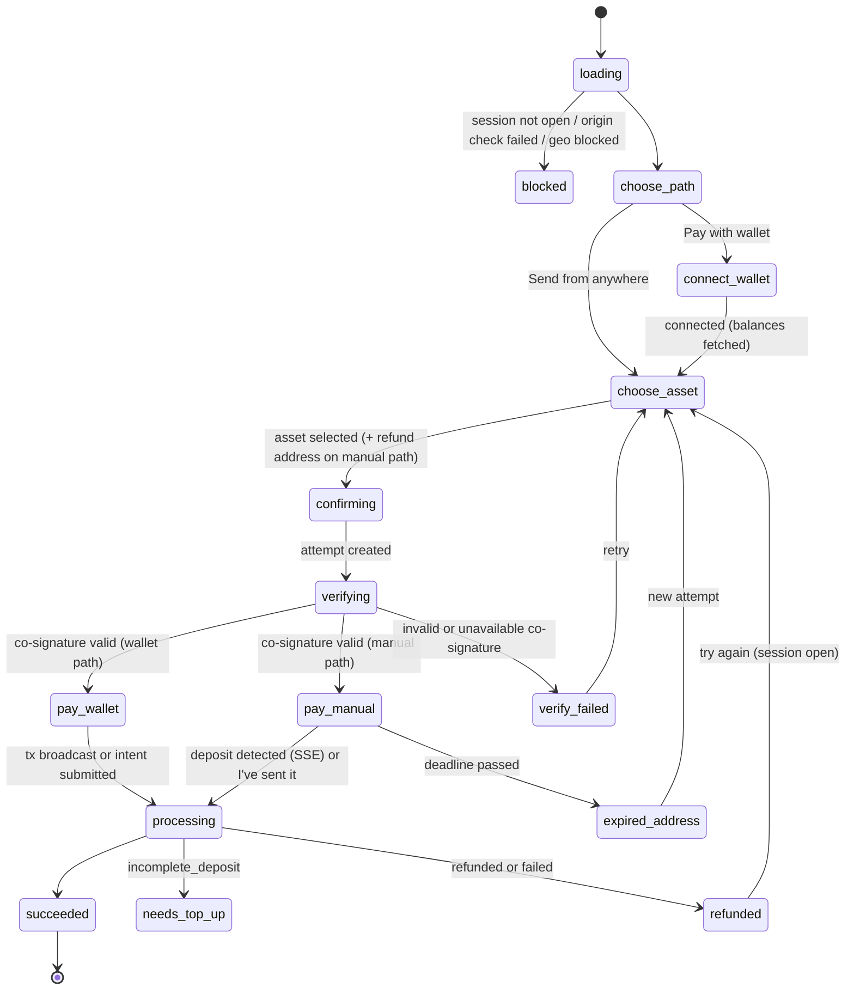

# LLD — `nearpay-checkout` and `nearpay-js`

> Version 1.0 · ADR-0010 · Flows §2–§3 · FR-PAY-03, FR-PAY-06, FR-PAY-10 · Foundations `00-foundations.md`

## 1. Scope

**checkout** (static SPA, `pay.nearpay.<tld>`): hosted checkout `/c/:id`, embedded `/embed/:id`, payment links `/l/:id`, hosted invoices `/i/:id` (Stage 3); wallet connection; asset choice; deposit instructions; Intents-transfer signing; live status; sentinel verification.
**js** (`js.nearpay.<tld>/v1/nearpay.js` + `@nearpay/js` + `@nearpay/react`): mounts the embedded checkout iframe and speaks the postMessage protocol.

## 2. Build and hosting

Vite build → hashed assets; `index.html` with strict CSP; served by Traefik's static file server (local) / Cloudflare (server stage). Build-time constants: `VITE_API_ORIGIN`, `VITE_SENTINEL_KEYS` (JSON `[{kid, public_key}]` — **pinned**), `VITE_TURNSTILE_SITEKEY`, `VITE_WALLETCONNECT_PROJECT_ID`, `VITE_NEAR_NETWORK`.

**CSP (hosted):** `default-src 'none'; script-src 'self' https://challenges.cloudflare.com; style-src 'self'; img-src 'self' data:; connect-src 'self' <API> <EVM/NEAR RPC + WalletConnect relays>; frame-src https://challenges.cloudflare.com; frame-ancestors 'none'; base-uri 'none'; form-action 'none'`.
**CSP (embed route):** same but `frame-ancestors https:` (and `http://localhost:*` in local), plus the runtime ancestor check in §5.

## 3. Code layout

```
src/routes/session/   hosted flow       src/routes/embed/      iframe flow + protocol
src/routes/payment-link/                src/routes/invoice/    (Stage 3)
src/features/asset-picker/      options list, balances, route availability
src/features/wallet-connect/    NEAR Connect, EVM (EIP-6963 injected + WalletConnect), Solana (Stage 4)
src/features/deposit-instructions/  address, QR, memo, network guard, countdown, "I've sent it"
src/features/refund-address/    validation per chain, exchange-address warning
src/features/status-stream/     SSE client with polling fallback
src/lib/api/                    typed client from @nearpay/spec (public payer routes only)
src/lib/integrity/              sentinel verification (JCS + Ed25519), fingerprint rendering
src/wallets/near|evm|solana/    tx builders
```

## 4. UI state machine



## 5. Critical rules

1. **Client secret** comes from the URL fragment, is kept in memory only, never logged, never stored.
2. **Two-party release (FR-PAY-10):** after `POST …/attempts`, call `POST /v1/attestations/deposit_instructions` with the attempt's instructions; verify `signature` with a pinned key (`kid` must be pinned), JCS over `attestation`, and assert every displayed field equals the attested field (address, memo, chain, origin asset, amount_in, deadline, pay_to/requirement). Render the **attested** merchant name, KYB badge and destination fingerprint. Any failure → no address, no wallet prompt.
3. **Embedded mode origin check:** the iframe accepts `np:init` only from `event.origin ∈ session.allowed_origins`; also checks `location.ancestorOrigins[0]` when available; mismatch → `blocked`.
4. **Wallet path builds the transfer inside the iframe:**
   - EVM ERC-20: `transfer(depositAddress, amount_in)` on the token contract; enforce `chainId` switch; native asset: value transfer.
   - NEAR NEP-141: check `storage_balance_of(deposit)`; batch `storage_deposit` (if needed) + `ft_transfer({receiver_id: deposit, amount: amount_in, memo})` via NEAR Connect `signAndSendTransactions`; wNEAR from native NEAR: `near_deposit` + transfer in the same batch.
   - Intents balance (`intents_transfer` attempts): build the Verifier message (foundations §14) from the attested requirement; NEAR wallets sign NEP-413 (`signMessage({message, recipient:'intents.near', nonce})`); EVM wallets sign ERC-191 (`personal_sign` of the payload string); submit to `…/attempts/{pa}/signed_intent`.
   - After broadcast → `…/deposit_tx {tx_hash}`.
5. **Manual path guards:** network name + icon above the address; checkbox "I'm sending on <network>"; memo shown first with checkbox "I included the memo" when present; QR encodes EIP-681 for EVM tokens / plain address otherwise; refund address required, validated per chain, warning "use a wallet you control, not an exchange deposit address".
6. **Deadline:** countdown from the attested `deadline`; at 0 the address is replaced by "This address has expired — do not send".
7. **One visible attempt:** creating a new attempt hides the previous one with the "don't send again" notice.
8. **Test mode:** banner "Test mode — no real funds"; "Simulate payment" calls `POST …/attempts/{pa}/simulate_deposit` (payments test helper → sandbox).
9. Success → redirect `success_url` with `?session_id=cs_…` (hosted) or `np:complete` (embedded).

## 6. `nearpay-js` protocol (v1)

| Direction | Message | Payload |
|---|---|---|
| parent → iframe | `np:init` | `{v:1, appearance:{theme, accent, radius}, locale}` |
| iframe → parent | `np:ready` | `{v:1}` |
| iframe → parent | `np:resize` | `{height}` |
| iframe → parent | `np:complete` | `{session_id, payment_intent_id}` |
| iframe → parent | `np:error` | `{code, message}` |
| iframe → parent | `np:close` | `{}` |

API: `const np = NearPay('pk_live_…'); const checkout = np.mountCheckout({sessionId, clientSecret, element, appearance?, onComplete, onError}); checkout.destroy()`. The loader validates `pk_` prefix and session ID format, creates `<iframe src="https://pay…/embed/<id>#<client_secret>" sandbox="allow-scripts allow-same-origin allow-popups allow-forms" allow="clipboard-write">`, and only accepts messages whose `event.origin === PAY_ORIGIN`. React: `<NearPayCheckout sessionId clientSecret onComplete />`. Loader URL is versioned and immutable; releases publish SRI hashes.

## 7. Accessibility, i18n, performance

WCAG 2.2 AA; English in v1 with ICU message catalogs; initial JS ≤ 180 KB gzipped (wallet SDKs lazy-loaded on "Pay with wallet"); first paint < 1.5 s on 4G.

## 8. Tests

Unit: sentinel verification vectors (shared with sentinel), field-equality assertions, refund-address validators, amount formatting. Playwright (testbed, sandbox): every UI state, scenarios 00–07, embed origin mismatch, tampered attestation, expired address. Manual mainnet checklist per stage demo.

## 9. Stage mapping

Stage 1: hosted + embed, NEAR + EVM wallets, manual path, Intents-transfer signing, sentinel verification, SSE, test mode, js loader + React. Stage 2: payment links. Stage 3: hosted invoices. Stage 4: Solana wallets.
