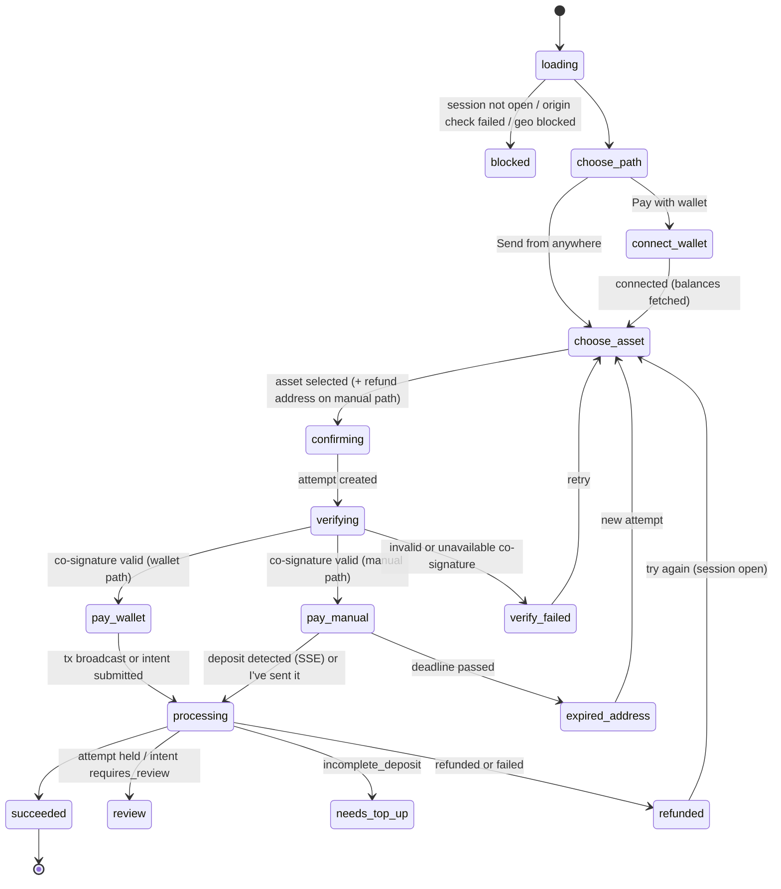

# LLD — `nearpay-checkout` and `nearpay-js`

> Version 1.3 (step 1.3 implementation findings folded: build constants and CSP §2, UI states §4, rules §5, protocol and API §6, i18n and budget §7, tests §8, open items §10) · Version 1.1 audited (`audits/checkout-and-js.md`) · ADR-0010 · Flows §2–§3 · FR-PAY-03, FR-PAY-06, FR-PAY-10 · Foundations `00-foundations.md`

## 1. Scope

**checkout** (static SPA, `pay.nearpay.<tld>`): hosted checkout `/c/:id`, embedded `/embed/:id`, payment links `/l/:id`, hosted invoices `/i/:id` (Stage 3); wallet connection; asset choice; deposit instructions; Intents-transfer signing; live status; sentinel verification.
**js** (`js.nearpay.<tld>/v1/nearpay.js` + `@nearpay/js` + `@nearpay/react`): mounts the embedded checkout iframe and speaks the postMessage protocol.

## 2. Build and hosting

Vite build → hashed assets; `index.html` with strict CSP; served by nginx behind Traefik (local; `frame-ancestors` is sent as a header per route, since a meta CSP cannot carry it) / Cloudflare (server stage). Build-time constants:
- `VITE_API_ORIGIN` — default the relative `/api` (the API is reached same-origin through the gateway, so there is no CORS, and one build serves any domain); an absolute https origin is still accepted and added to `connect-src`.
- `VITE_SENTINEL_KEYS` (JSON `[{kid, public_key}]` — **pinned**) — falls back to the file named by `NP_SENTINEL_KEYS_FILE`, then `../nearpay-deploy/.secrets/public/sentinel_keys.json` (written by `seed.sh keys`); a production build without keys **fails**. The E2E build (`--mode e2e` → `dist-e2e/`) pins the spec test-vector key instead, so `dist/` never carries test keys.
- `VITE_TURNSTILE_SITEKEY` — defaults to Cloudflare's always-pass test sitekey (pairs with the local test secret); production builds must set it.
- `VITE_NEAR_RPC_URL` (default `https://free.rpc.fastnear.com`) — the wallet path needs NEAR view calls (`storage_balance_of`, `storage_balance_bounds`, Verifier `current_salt`).
- `VITE_WALLETCONNECT_PROJECT_ID` (reserved; WalletConnect is not built in Stage 1, §10), `VITE_NEAR_NETWORK`.

**CSP nonce on a static site:** `index.html` carries `'nonce-{{NP_CSP_NONCE}}'` in the meta CSP and `<meta name="np-csp-nonce">`; nginx replaces the placeholder with the per-response `$request_id` (`sub_filter`, pay `/` and `/embed/`; platform §1). NEAR Connect runs wallet executors in `srcdoc` frames that inherit the page CSP, so it cannot work without a real per-response nonce; its popup `<style>` elements are re-inserted with the nonce. Unsubstituted, the placeholder is an invalid CSP source: the policy stays strict and NEAR wallets are disabled.

**CSP (hosted):** `default-src 'none'; script-src 'self' 'nonce-…' https://challenges.cloudflare.com; style-src 'self' 'nonce-…'; img-src 'self' data:; font-src 'self'; connect-src 'self' <absolute API origin, if any> <NEAR RPC> https://raw.githubusercontent.com https://cdn.jsdelivr.net (NEAR Connect manifest + executors); frame-src https://challenges.cloudflare.com; base-uri 'none'; form-action 'none'; object-src 'none'` + header `frame-ancestors 'none'`. `img-src` stays `'self' data:`: remote wallet icons are not shown; EIP-6963 icons must be `data:` URIs.
**CSP (embed route):** same but `frame-ancestors https:` (and `http://localhost:*` in local), plus the runtime ancestor check in §5.

## 3. Code layout

```
src/routes/session/   hosted flow       src/routes/embed/      iframe flow + protocol
src/routes/payment-link/                src/routes/invoice/    (Stage 3)
src/features/asset-picker/      options list, balances, route availability
src/features/wallet-connect/    NEAR Connect, EVM (EIP-6963 injected + WalletConnect), Solana (Stage 4)
src/features/deposit-instructions/  address, QR, memo, network guard, countdown, "I've sent it"
src/features/refund-address/    validation per chain, exchange-address warning
src/features/status-stream/     fetch-based SSE client (sends the client-secret header; `EventSource` cannot), polling fallback every 3 s
src/lib/api/                    typed client from @nearpay/spec (public payer routes only)
src/lib/integrity/              sentinel verification (JCS + Ed25519), fingerprint rendering
src/wallets/near|evm|solana/    tx builders
```

## 4. UI state machine


`review` shows "payment received — under review, don't pay again". `confirming` is also the resume state for an attempt still `quoting`. **Resume on reload:** a live `route_quote` attempt is re-verified with sentinel and shown on the manual path; a live `intents_transfer` attempt is not resumed (the payer starts a new attempt).

## 5. Critical rules

1. **Client secret** comes from the URL fragment, is kept in memory only, never logged, never stored. The fragment is left in the address bar so a reload keeps working.
2. **Two-party release (FR-PAY-10):** after `POST …/attempts`, call `POST /v1/attestations/deposit_instructions` with the attempt's instructions and its `attestation_ticket`; verify `signature` with a pinned key (`kid` must be pinned), JCS over `attestation` **exactly as received** (unknown fields included), and assert every displayed field equals the attested field (address, memo, chain, origin asset, amount_in, deadline, pay_to/requirement), `expires_at ≤ deadline` and `expires_at > now`; instructions are hidden at `min(deadline, expires_at)`. Render the **attested** merchant name, KYB badge and destination fingerprint; `display.merchant_name_unverified` is never rendered, not even before verification (L-CK-03). The session's `settlement.{asset_id, chain}` is not compared with the attested destination (both come from sources the checkout does not trust; the payer checks name + fingerprint). Any failure → no address, no wallet prompt.
3. **Embedded mode origin check:** the parent bridge is installed before React renders (an early `np:init` is buffered). The iframe accepts `np:init` only from the parent window with `event.origin ∈ session.allowed_origins`; also checks `location.ancestorOrigins[0]` when available. A disallowed parent is blocked at once; `np:init` from any other window is ignored; the embed route opened top-level → `blocked`. Blocked states reached after verification are reported with `np:error {code: <reason>}`. Appearance: theme `light|dark|auto`, accent `#rgb`/`#rrggbb`, radius 0–24 px (CSS custom properties).
4. **Wallet path builds the transfer inside the iframe:**
   - EVM ERC-20: `transfer(depositAddress, amount_in)` on the token contract; enforce `chainId` switch; native asset: value transfer.
   - NEAR NEP-141: check `storage_balance_of(deposit)`; batch `storage_deposit` (if needed) + `ft_transfer({receiver_id: deposit, amount: amount_in, memo})` via NEAR Connect `signAndSendTransactions`; wNEAR from native NEAR: `near_deposit` + transfer in the same batch.
   - Intents balance (`intents_transfer` attempts): build the Verifier message (foundations §14) from the attested requirement; NEAR wallets sign NEP-413 (`signMessage({message, recipient:'intents.near', nonce})`); EVM wallets sign ERC-191 (`personal_sign` of the payload string); submit to `…/attempts/{pa}/signed_intent`.
   - Wallet assets: EVM only for omft-bridged assets (`nep141:<prefix>-0x<contract>.omft.near`, native `nep141:<prefix>.omft.near`) whose prefix belongs to the option's chain (eth/base/arb/gnosis); NEAR for NEP-141 token accounts; `wrap.near` always wraps the full amount from native NEAR. Other assets are manual-path only (a typed token field on payment options is requested for spec 0.1.5).
   - Intents signing in test mode uses the sandbox salt `5a0dbe11`, never a mainnet salt, so a test payload cannot execute on mainnet.
   - After broadcast → `…/deposit_tx {tx_hash}`. Failures of `submitDepositTx` / `signalDepositSent` are ignored (detection works without them).
5. **Manual path guards:** network name + icon above the address; checkbox "I'm sending on <network>"; memo shown first with checkbox "I included the memo" when present; address, amount and QR are revealed only after the checkboxes are ticked, and "I've sent it" stays disabled until then; QR encodes EIP-681 for EVM ERC-20s / plain address otherwise (native assets included); refund address required, validated per chain, warning "use a wallet you control, not an exchange deposit address".
6. **Deadline:** countdown from the attested `deadline`; at 0 the address is replaced by "This address has expired — do not send".
7. **One visible attempt:** creating a new attempt hides the previous one with the "don't send again" notice.
8. **Test mode:** banner "Test mode — no real funds"; "Simulate payment" calls `POST …/attempts/{pa}/simulate_deposit` (payments test helper → sandbox). Test mode **never broadcasts a wallet transaction** (INV-8: sandbox deposit addresses mirror mainnet formats); the wallet path shows "Simulate payment" instead.
9. Success → redirect `success_url` with `?session_id=cs_…` (hosted; only `http(s)` URLs — `javascript:`/`data:` refused; 2.5 s delay plus a link) or `np:complete` (embedded).

## 6. `nearpay-js` protocol (v1)

| Direction | Message | Payload |
|---|---|---|
| parent → iframe | `np:init` | `{v:1, appearance:{theme, accent, radius}, locale}` — (re)posted to `PAY_ORIGIN` on frame load and every 250 ms until `np:ready` (≤ 40 times) |
| iframe → parent | `np:ready` | `{v:1}` |
| iframe → parent | `np:resize` | `{height}` (clamped to 120–4000 px by the parent) |
| iframe → parent | `np:complete` | `{session_id, payment_intent_id}` — delivered once, only for the mounted session; `payment_intent_id` may be `null` (the checkout learns the intent id only from the SSE `intent` event; `PublicCheckoutSession.payment_intent` is requested for spec 0.1.5) |
| iframe → parent | `np:error` | `{code, message}` |
| iframe → parent | `np:close` | `{}` |

Every message is `{type, v: 1, …}`; protocol v1 is written down in `nearpay-js/protocol/v1.md` (+ `v1.json`).

API: `const np = NearPay('pk_live_…', {payOrigin?}); const checkout = np.mountCheckout({sessionId, clientSecret, element, appearance?, locale?, onReady?, onComplete, onError, onClose?}); checkout.iframe; checkout.destroy()`. The loader validates the `pk_` prefix (`sk_`/`rk_` keys are refused with an explicit error) and session ID format, creates `<iframe src="https://pay…/embed/<id>#<client_secret>" sandbox="allow-scripts allow-same-origin allow-popups allow-forms" allow="clipboard-write">`, and accepts a message only if `event.origin === PAY_ORIGIN` **and** `event.source === iframe.contentWindow` (origin alone would accept other pay-origin frames on the page). `PAY_ORIGIN` comes from `payOrigin`, else from the loader's own URL (`js.<domain>` → `pay.<domain>`, port kept; `http` only for `localhost`/`*.localhost`), else the build default `NP_PAY_ORIGIN` (`https://pay.nearpay.money`), so one `dist/v1/nearpay.js` serves every deployment. React: `<NearPayProvider publishableKey>` + `<NearPayCheckout sessionId clientSecret onComplete />` (or a `publishableKey` prop). Release artefacts: `dist/v1/nearpay.js` + `dist/v1/integrity.json` (sha384, sha512). `/v1/` is the protocol major, not a release: the file changes with releases and is served with a 5-minute cache, not as immutable (platform §1), so SRI pinning breaks on update; immutable per-release paths are not built.

## 7. Accessibility, i18n, performance

WCAG 2.2 AA; English in v1 with a flat message catalog using `{var}` placeholders (no ICU plural rules needed yet); initial JS ≤ 180 KB gzipped (143 KB at step 1.3; wallet SDKs lazy-loaded on "Pay with wallet", NEAR Connect 14 KB); first paint < 1.5 s on 4G.

## 8. Tests

Unit: vectors from `@nearpay/spec/test-vectors` (attestations, fingerprints, NEP-413/ERC-191 payloads), field-equality assertions, refund-address validators, amount formatting. Playwright in the repo against an in-process spec-validating mock (payer routes + sentinel signing with the test-vector key), with a CSP-violation guard on every test. Playwright (testbed, sandbox): every UI state, scenarios 00–07, embed origin mismatch, tampered attestation, expired address. Manual mainnet checklist per stage demo.

## 9. Stage mapping

Stage 1: hosted + embed, NEAR + EVM wallets, manual path, Intents-transfer signing, sentinel verification, SSE, test mode, js loader + React. Stage 2: payment links. Stage 3: hosted invoices. Stage 4: Solana wallets.

## 10. Open items from step 1.3

- WalletConnect (§3) is not built; `VITE_WALLETCONNECT_PROJECT_ID` is reserved. EVM wallets are injected (EIP-6963).
- Wallet balances are not fetched client-side; the server ranks options with `?wallet=`.
- Amounts are displayed with decimals and symbol from payments' payment options, which are not attested. Misreported decimals can only cause an over- or underpayment that the route refunds, never a redirect of funds (attesting them is a later sentinel request, `roadmap/open-questions.md`).
- NEAR Connect loads a remote, mutable manifest and executors (GitHub `main`); pin a reviewed manifest with commit-pinned executor URLs before mainnet. Real wallets are untested in the build environment.
