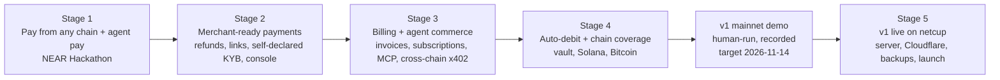

# Development Plan — stages and steps

> Version 1.2 (owner decisions 2026-11-07, ADR-0020: test-mode stage gates, one v1 mainnet demo, self-declared KYB, local screening, keyless FX/prices, AI vault audits, merges by the lead agent) · Version 1.1 (git workflow, ADR-0017) · Baseline: HLD v1.1, LLD set v1.1 (dev-ready), ADR-0015/0016/0017/0020 · Owner: Principal Engineer
> v1 = Stages 1–4 (local Docker Compose against NEAR mainnet), **targeted for 2026-11-14** with parallel AI agents (ADR-0020). Stage 5 moves v1 onto one netcup server.

## 1. Rules for every stage

- **Each stage exits on a green test-mode E2E suite** (ADR-0020): the stage's E2E scenarios in `nearpay-testbed` pass against the full Compose stack on the sandbox rail, from a clean `scripts/bootstrap.sh`. The former per-stage demo scripts are E2E scenarios of their stage.
- **One mainnet demo at the end of v1** (§6.1): a human runs it from the entry repo's README after Stage 4 exits, recorded on video (also the hackathon video, ADR-0016 as amended by ADR-0020). It replaces step 1.5 and the step 2.4/3.4/4.4 mainnet demos.
- **Steps are gates.** Inside a step, every listed repo is built **in parallel** (one AI agent or engineer per repo). A step starts only when the previous step's exit criteria pass.
- **Contract freeze:** the first step of each stage releases `@nearpay/spec` / `@nearpay-internal/spec` (and `nearpay-kit`) at a tagged version to the local registry; repos in later steps of that stage build against that version only. A contract change mid-stage is a change request: spec PR → new patch version → affected repos bump in the same step.
- **Definition of done per repo:** LLD sections for the stage implemented; unit + property + integration + contract tests green; `AGENTS.md` rules respected; money-path changes reviewed and merged by the lead agent with every CODEOWNERS-path check green — invariant property tests, contract tests, stage E2E — never with a red or skipped check (ADR-0020, amends ADR-0017); brain updated in the same change set; commit per finished feature.
- **Git workflow (ADR-0017):** `main` is the latest build; each step is built on a branch `stage-<n>/<step>-<topic>` from `main` in every repo it touches and joins `main` through a pull request. Agents push feature branches and open the pull requests; **the lead agent reviews and merges** them, including money-path pull requests (ADR-0020).
- **Human-only actions** (rules + ADR-0016, amended by ADR-0017 and ADR-0020): providing credentials and accounts, signing mainnet transactions, spending funds, mainnet deployment (incl. the vault), running the v1 mainnet demo, the first push of `main` to a new remote, making repos public, posting, submitting. Merging pull requests is delegated to the lead agent (ADR-0020).
- **No vendors in v1** (ADR-0020): KYB is self-declared with an ops decision; address screening uses the local OFAC list + blocklist behind a vendor-neutral interface; FX and secondary prices come from keyless public sources (ECB reference rates, a public crypto price feed) behind provider interfaces.

## 2. Stage overview

## 3. Stage 1 — Pay from any chain + agent pay (NEAR Hackathon)

**Deadline:** code, README and demo ready by **2026-11-14 23:59 UTC** (repos public, X post with video, submission — human actions). Tracks: Real-World Money, Agent Economy.

| Step | Repos built in parallel | Scope (LLD sections tagged Stage 1) | Exit criteria |
|---|---|---|---|
| **1.1 Foundations** | `nearpay-spec`, `nearpay-kit`, `nearpay-deploy`, `nearpay` | spec: Stage 1 public/internal routes, events, webhook types, x402 scheme, error catalogue, test vectors · kit: all packages · deploy: Compose local profile (Postgres init, NATS, Valkey, Traefik routes + ForwardAuth, egress proxy, Mailpit, Verdaccio registry), key seeding, `up.sh` · entry: scripts | `@nearpay/spec@0.1.0` + kit `0.1.0` in local registry; `scripts/up.sh local` boots platform containers healthy; spec compat test green |
| **1.2 Services** | `nearpay-identity`, `nearpay-payments`, `nearpay-rails`, `nearpay-sentinel`, `nearpay-agentpay`, `nearpay-compliance`, `nearpay-webhooks`, `nearpay-notify`, `nearpay-sandbox` | each service's Stage 1 scope (LLD §16) with Testcontainers integration tests and spec contract tests; mocks of peers generated from spec | every service image builds, migrates, passes its tests, and is healthy in Compose |
| **1.3 Clients** (starts with 1.2, against spec mocks) | `nearpay-checkout`, `nearpay-js`, `nearpay-dashboard`, `nearpay-agentkit`, `nearpay-node`, `nearpay-testbed` | checkout hosted + embed, NEAR/EVM wallets, manual path, sentinel verification · js loader + React · dashboard onboarding (signup, destination + attestation, keys, webhooks, payments list, agent payments) · `@nearpay/x402` + `@nearpay/agent-signer` · node SDK subset (sessions, intents, webhook verify) · testbed: merchant-demo, `demo:checkout`, `demo:agent`, E2E suites | components pass unit + mock-backed Playwright tests |
| **1.4 Integration** | `nearpay-testbed` (lead), fixes in any repo | full stack in Compose; sandbox scenarios 00–07 green; traces T1–T7 (`lld/audits/system.md`) green in test mode; README "Try it" steps 1–5 verified by the `readme-check` job | all E2E green on a clean machine from `scripts/bootstrap.sh` |
| ~~**1.5 Mainnet demo**~~ — **mainnet demo deferred to the v1 demo (ADR-0020, §6.1)** | `nearpay-testbed`, `nearpay` (README), owner | owner provides: NEAR accounts (merchant demo, treasury, relayer + 4 function-call keys), small funds (USDC on Base or Arbitrum, USDC in a NEAR Intents balance for the agent), optionally a 1Click API key; ops CLI KYB approval locally | **Demo script below** passes on mainnet; video recorded; README step 6 verified |

**Stage 1 mainnet demo script** *(history — runs as part 1 of the v1 mainnet demo, §6.1; its steps 2–5 are already covered in test mode by traces T1–T7)*
1. Merchant signs up, adds a USDC **NEAR Intents account** destination, signs the attestation with a NEAR wallet; ops CLI approves KYB → account live.
2. Merchant backend (`merchant-demo`) creates a USD 2.00 checkout session.
3. Payer opens the hosted checkout, connects an EVM wallet holding USDC on Base, sees the sentinel-verified merchant name and destination fingerprint, pays.
4. Within ~1–2 minutes the merchant's Intents balance shows USD 2.00 USDC + tag; `payment_intent.succeeded` arrives at `merchant-demo` with a valid signature; dashboard shows the evidence link.
5. An AI agent calls `merchant-demo/premium`, receives `402`, signs a NEAR Intents transfer, receives the resource with `PAYMENT-RESPONSE` in ~2 s; `agent_payment.settled` webhook arrives.

**Stage 1 cut list (applied in this order only if 1.4 is late):** dashboard pages beyond onboarding → seed CLI · embedded mode → hosted only · human Intents-balance path → agents only · EVM watchers → provider SUCCESS + receipt verifier only. Never cut: sentinel co-signing, evidence-before-success, webhook signatures, test mode.

## 4. Stage 2 — Merchant-ready payments

| Step | Repos in parallel | Scope |
|---|---|---|
| 2.1 Contracts | `nearpay-spec`, `nearpay-kit` | refunds, payment links, customers, team, restricted keys, self-declared KYB (minimum business details; ops decision route), console routes, reconciliation, Explorer, FX + secondary-price provider interfaces, nullish `OneClick*` fields (mainnet finding, `open-questions.md`) |
| 2.2 Services | `nearpay-payments`, `nearpay-rails`, `nearpay-identity`, `nearpay-compliance`, `nearpay-webhooks`, `nearpay-notify`, `nearpay-agentpay`, `nearpay-sentinel` | refunds + legs (route + Intents), payment links, customers, review decisions, reconciliation · rails refunds, Explorer feed (owner token), secondary prices + FX from keyless public sources behind provider interfaces — ECB reference rates, a public crypto price feed (non-par settlement, multi-currency; ADR-0020) · identity team, invitations, two-approver rule, restricted keys, recovery · compliance self-declared KYB submission + ops decision (no vendor), vendor-neutral screening interface over the local OFAC list + blocklist, re-screening (ADR-0020) · webhooks rotation/resend/delivery API · notify KYB/refund/member templates · agentpay Intents refunds relay · sentinel two-person kill-switch release |
| 2.3 Clients | `nearpay-dashboard`, `nearpay-console`, `nearpay-checkout`, `nearpay-node`, `nearpay-site` | refunds with wallet signing, team, self-declared KYB form, customers, links · console (merchants, KYB decisions on self-declared details, cases, holds, findings, reconciliation) · payment-link route · full node SDK · docs site |
| 2.4 Integration (test-mode E2E) | `nearpay-testbed`, fixes in any repo | **Exit: Stage 2 E2E green in test mode.** E2E scenarios (former demo script): refund a payment back to the payer's origin chain (merchant signs in the dashboard); pay a payment link from a different chain; merchant submits self-declared KYB and ops approves it in the console → live mode; daily reconciliation with zero diffs |

## 5. Stage 3 — Billing and agent commerce

| Step | Repos in parallel | Scope |
|---|---|---|
| 3.1 Contracts | `nearpay-spec`, `nearpay-kit` | billing resources and events, hosted invoice, events stream, `near-intents` x402 method |
| 3.2 Services | `nearpay-billing`, `nearpay-payments`, `nearpay-agentpay`, `nearpay-rails`, `nearpay-webhooks`, `nearpay-notify` | products/prices/tax rates/invoices/subscriptions (`send_invoice`), dunning, PDFs · internal invoice sessions · cross-chain x402 (rails owner `agentpay`) · events SSE stream · billing emails |
| 3.3 Clients | `nearpay-checkout`, `nearpay-dashboard`, `nearpay-agentkit`, `nearpay-cli`, `nearpay-site` | hosted invoices · billing pages · MCP server · CLI (`login`, `listen`, `trigger`) · billing + agent guides |
| 3.4 Integration (test-mode E2E) | `nearpay-testbed`, fixes in any repo | **Exit: Stage 3 E2E green in test mode.** E2E scenarios (former demo script): invoice paid from Solana/EVM into a NEAR destination; subscription renewal invoice issued and paid; an MCP-driven agent pays a checkout session and a cross-chain x402 resource |

## 6. Stage 4 — Auto-debit and chain coverage (completes v1)

| Step | Repos in parallel | Scope |
|---|---|---|
| 4.1 Contract + contracts | `nearpay-contracts`, `nearpay-spec` | subscription vault (tests, fuzzing, gas profile), vault event schemas; **independent AI-agent audits start** (auditor agents that did not write the contract; replaces the two external audits, ADR-0020) |
| 4.2 Services | `nearpay-billing`, `nearpay-rails`, `nearpay-identity`, `nearpay-sentinel` | mandates + keeper + auto-debit, vault event forwarding · Solana + Bitcoin watchers/verifiers (Tier A) · Solana/BIP-322 attestations · sentinel coverage for new chains |
| 4.3 Clients | `nearpay-checkout`, `nearpay-dashboard`, `nearpay-agentkit` | Solana wallets, mandate funding UI, mandate management |
| 4.4 Integration (test-mode E2E) | `nearpay-testbed`, fixes in any repo | AI audits closed (every finding fixed or accepted with a note). **Exit: Stage 4 E2E green in test mode.** E2E scenarios (former demo script; test-mode mandates need a vault stand-in — OQ-T-03): payer funds a mandate, keeper collects period 1, merchant receives into its Intents account, payer cancels and withdraws the remainder; a Solana payer completes a checkout |

**v1 complete** when Stage 4 exits and the v1 mainnet demo (§6.1) passes: every LLD section tagged Stages 1–4 is implemented and every stress-test scenario is automated in the testbed.

### 6.1 v1 mainnet demo (the only mainnet demo of v1, ADR-0020)

| Step | Who | Scope | Exit criteria |
|---|---|---|---|
| **V.1 Mainnet demo** | `nearpay-testbed`, `nearpay` (README), owner | owner provides: NEAR accounts (merchant demo, treasury, relayer + 4 function-call keys, keeper key), small funds (USDC on Base or Arbitrum, USDC in a NEAR Intents balance for the agent, a little SOL/USDC on Solana), optionally a 1Click API key; owner deploys the vault on mainnet (keys deleted, human-signed) with a low global TVL cap; ops approves the demo merchant's self-declared KYB in the console | **v1 demo script below** passes on mainnet; video recorded (hackathon video, deadline 2026-11-14 23:59 UTC); README demo steps verified |

**v1 mainnet demo script** (run from the entry repo's README; each part is already green as a test-mode E2E scenario)
1. **Onboarding and checkout (Stage 1).** Merchant signs up, submits self-declared business details, adds a USDC **NEAR Intents account** destination and signs the attestation with a NEAR wallet; ops approves KYB in the console → account live. `merchant-demo` creates a USD 2.00 checkout session; payer pays from an EVM wallet with USDC on Base after seeing the sentinel-verified merchant name and destination fingerprint; within ~1–2 minutes the merchant's Intents balance shows USD 2.00 USDC + tag, `payment_intent.succeeded` arrives signed, the dashboard shows the evidence link.
2. **Agent pay (Stage 1).** An AI agent calls `merchant-demo/premium`, receives `402`, signs a NEAR Intents transfer, receives the resource with `PAYMENT-RESPONSE` in ~2 s; `agent_payment.settled` arrives.
3. **Merchant operations (Stage 2).** Merchant refunds the step-1 payment back to the payer's origin chain (signs in the dashboard); a payer pays a payment link from a different chain; the daily reconciliation shows zero diffs.
4. **Billing and agent commerce (Stage 3).** An invoice is paid from Solana or EVM into the NEAR destination; a subscription renewal invoice is issued and paid; an MCP-driven agent pays a checkout session and a cross-chain x402 resource.
5. **Auto-debit and chain coverage (Stage 4).** A payer funds a vault mandate, the keeper collects period 1, the merchant receives it in its Intents account, the payer cancels and withdraws the remainder; a Solana payer completes a checkout.

**v1 demo cut list (proposed; the owner confirms before applying, in this order):** part 5 auto-debit on mainnet → shown in test mode only, vault not deployed · part 4 → test mode only · part 3 payment link → test mode only. Never cut: parts 1–2, sentinel co-signing, evidence-before-success, webhook signatures.

## 7. Stage 5 — v1 live on a netcup server

| Step | Repos in parallel | Scope |
|---|---|---|
| 5.1 Platform | `nearpay-infra`, `nearpay-deploy` | Ansible host hardening + docker-host + WireGuard admin; Terraform Cloudflare (DNS, proxy, AOP, WAF, Turnstile, Access) + EU object storage; Compose server profile; WAL-G + restore drill; observability on server; GitHub remotes + GHCR/registry switch (owner pushes) |
| 5.2 Production readiness | `nearpay-notify`, `nearpay-site`, `nearpay-testbed` | Postmark/SES + bounces; marketing + legal pages; public docs; external status page; canary schedule; load test at P1 peak ×3 on the server |
| 5.3 Security + go-live | all, owner | external pentest (checkout, identity, sentinel), legal opinion for launch jurisdiction (Q-LEG-01), trademark check (Q-BIZ-01), runbook drills RB-01/RB-02/RB-07/RB-11 |
| 5.4 Launch demo | owner | **Demo:** `https://pay.nearpay.money` live checkout paid on mainnet end to end on the netcup server; hosted agent-payment demo; status page green |

## 8. Repo × stage matrix

| Repo | S1 | S2 | S3 | S4 | S5 |
|---|---|---|---|---|---|
| nearpay (entry) | ● | ○ | ○ | ○ | ● |
| nearpay-spec, nearpay-kit | ● | ● | ● | ● | ○ |
| nearpay-identity | ● | ● | | ● | |
| nearpay-payments | ● | ● | ● | | |
| nearpay-rails | ● | ● | ● | ● | |
| nearpay-sentinel | ● | ● | | ● | |
| nearpay-agentpay | ● | ● | ● | | |
| nearpay-compliance | ● | ● | | | |
| nearpay-webhooks | ● | ● | ● | | |
| nearpay-notify | ● | ● | ● | | ● |
| nearpay-sandbox | ● | ○ | ○ | ○ | |
| nearpay-billing | | | ● | ● | |
| nearpay-checkout, nearpay-js | ● | ● | ● | ● | |
| nearpay-dashboard | ● | ● | ● | ● | |
| nearpay-console | | ● | | | |
| nearpay-agentkit | ● | | ● | ● | |
| nearpay-node | ● | ● | | | |
| nearpay-cli | | | ● | | |
| nearpay-site | | ● | ● | | ● |
| nearpay-contracts | | | | ● | |
| nearpay-deploy | ● | ○ | ○ | ○ | ● |
| nearpay-infra | | | | | ● |
| nearpay-testbed | ● | ● | ● | ● | ● |

● main work · ○ small additions (new routes, scenarios, config)
