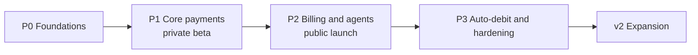

# Roadmap

> Version 1.0 · Sequenced by dependency, not dates (AI-agent-led delivery). A phase ends only when its exit criteria pass in `nearpay-testbed`.

| Phase | Scope (repos) | Exit criteria |
|---|---|---|
| **P0 Foundations** | `nearpay-spec` (public + internal contracts for P1), `nearpay-kit`, `nearpay-infra` (staging + prod sites), `nearpay-deploy`, `nearpay-testbed` (compose + CI), `nearpay-sandbox`, `nearpay-identity` | Staging cluster live via GitOps; restore drill green; sign-up → passkey → test keys → destination with attestation works end-to-end in sandbox; SP-01, SP-02, SP-03, SP-04 answered |
| **P1 Core payments** (private beta, ≤ 20 merchants) | `nearpay-payments` (incl. **refunds**), `nearpay-rails` (1Click, trackers, NEAR/EVM watchers, Tier-A verifiers for NEAR/EVM), `nearpay-sentinel`, `nearpay-compliance` (screening + KYB vendor), `nearpay-webhooks`, `nearpay-notify`, `nearpay-checkout`, `nearpay-js`, `nearpay-dashboard`, `nearpay-console`, `nearpay-node`, `nearpay-docs`, `nearpay-web` | All flows 1–4 and 8 pass on sandbox and on mainnet canaries; every stress-test scenario A–E automated in testbed; SLO dashboards live; security review + external pentest of checkout/identity; legal opinion for launch jurisdiction (Q-LEG-01) |
| **P2 Billing and agents** (public launch) | `nearpay-billing` (send_invoice), `nearpay-agentpay` (intents-transfer + near-intents), `nearpay-agentkit` (x402 middleware, signer, MCP) | Flows 5 and 7 pass; SP-07 measured; capacity re-baselined at D; public docs complete; status page public |
| **P3 Auto-debit and hardening** | `nearpay-contracts` (vault, 2 audits), billing auto-debit, `nearpay-cli`, Solana/Bitcoin watchers + verifiers, direct-intents provider, domain-anchored destinations | Vault audited with all findings closed; TVL cap set; DR rebuild-on-other-provider rehearsed; SP-06 resolved |
| **v2 Expansion** | E-commerce plugins, POS, Connect/splits, fiat ramps, Python/Go SDKs, EVM mandates, channel scheme for micro-payments, MNZ/SIN sites | Driven by demand |

## Definition of done (every phase)

- Contracts merged in `nearpay-spec` before implementation; consumer contract tests green.
- Invariant property tests (INV-1…9) green for touched aggregates.
- Runbooks for new failure modes added to `operations/runbooks.md`.
- `nearpay-brain` updated in the same change set (ADR if a decision changed).
